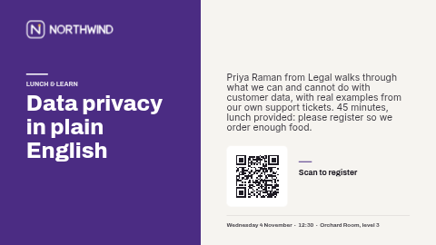

# Announcement — split

A two-tone notice: the headline on a block of your accent colour, the details beside it on a light background, with a footer line and an optional QR code. Good for sessions, trainings and sign-ups.

Two tones: a solid accent panel holding the headline, and a light panel with the details and QR code. Laid out in landscape (16:9). The portrait version is
[`announce-split-portrait`](../announce-split-portrait/).

**Kind:** slide (declarative, no code runs). Works on every ScreenTinker player that shows slides,
offline, with no internet access.

## Settings

| Setting | Type | Default | What it does |
| --- | --- | --- | --- |
| Logo | image | the bundled placeholder `logo.svg` | Top left. A transparent PNG or SVG works best; replace it with an image from your content library. |
| Small heading | text (40) | `LUNCH & LEARN` | Label above the headline, on the accent panel. |
| Headline | text (40) | `Data privacy in plain English` | The announcement itself, two or three lines on screen. Keep it short: a headline that wraps to an extra line runs into the details. |
| Details | textarea (240) | one or two sentences | Shown under the headline. Enter starts a new line. |
| Footer line | text (80) | `Wednesday 4 November  ·  12:30  ·  Orchard Room, level 3` | Who it is from, a date, a room or a contact. Plain text: type it the way it should read. |
| Show a QR code | checkbox | on | Off hides the code, its caption and its frame. Turn it off when you have no link: an empty link leaves a blank frame. |
| QR code link | text (300) | `https://example.com/northwind/register` | What the code opens. The code is drawn by the server; nothing is fetched. |
| QR caption | text (32) | `Scan to register` | Next to or under the code. |
| Show today's date | checkbox | off | A live date at the bottom of the accent panel. |
| Date style | select | Weekday, day and month | Weekday + day + month, full date with year, short date, or numbers only. |
| Date timezone | timezone | empty = the screen's clock | Which timezone "today" is in. |
| Language | locale | empty = the screen's language | The date is formatted by the screen in this language (`en-GB`, `de-DE`, `fr-CA` …). Every other word on the slide is your own text. |
| Accent colour | colour | `#4B2C83` | The large panel behind the headline, and the short rule by the QR caption. |
| Background colour | colour | `#F6F4F0` | The page. |
| Text colour | colour | `#1E1B24` | Headline, details and footer on the light side. |
| Text colour on the accent panel | colour | `#FFFFFF` | Headline, small heading, rule and date on the accent panel. Pick something that contrasts with the accent. |

## Tips

- Every element has a fixed place on the slide, so long text does not push the next block down: it
  overlaps it. Stay inside the character limits, and preview a long headline before putting it on
  screens. Two short sentences of details read better across a room than one long one.
- On a portrait screen use the `-portrait` version; this one would be letterboxed into a band across the middle.
- With the QR code turned off the layout keeps its shape and the space where the code was stays empty,
  which reads as intentional white space.
- The logo box is about four and a half times as wide as it is tall (the placeholder is a mark plus a
  wordmark). A wide logo fills it exactly; a square one sits centred in it.
- Test the QR code with a phone from where people will actually stand.
- In a thin strip zone the slide is letterboxed to keep its shape; use a ticker template for strips.

This is one of the **announcement pack**: `announce-bold`, `announce-card`, `announce-split` and `announce-minimal`, each in a landscape and a `-portrait` version with the same settings, so you can run the same notice on every screen in the building.

## Languages

The dashboard shows this template's name, description and settings in German, Spanish, French,
Hindi, Italian, Japanese, Dutch, Portuguese and Chinese (the files in `locales/`; English lives in
`manifest.json` and is the fallback). In those languages the text settings also come with a
translated example, written to fit this layout. Servers without translation support ignore
`locales/` and show the English.

On screen, every word is a setting you type in your own language. The only text the slide makes up
itself is the date, and that follows **Language** (empty = the screen's language).

The bundled fonts (Archivo, Inter) cover Latin scripts. Japanese, Chinese and Hindi are drawn with the
player's own fonts, so check one screen first: Android, Fire TV, Windows, ChromeOS, macOS, Tizen and
webOS have them; a minimal Linux image may need the Noto CJK and Devanagari fonts installed.

## Files

- `template.json`: the slide (`template` = layout, `fields` = the words), with `{{param:…}}` placeholders
- `logo.svg`: placeholder mark for the fictional "Northwind", original work, MIT (see `NOTICE`)
- `thumbnail.png`: catalog preview
- `locales/<lang>.json`: dashboard translations (de, es, fr, hi, it, ja, nl, pt, zh)

Licence: MIT (see `LICENSE`).
