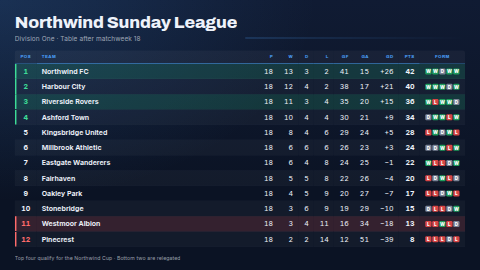

# Data table

Any table, shown as a clean board you can read across a room: a sports league table, savings rates
with their small print, stock levels, a timetable, a price list. The column headings come from your
data, numbers line up on the right, rows are striped, and the text is sized to fill the screen. A
table too long to read comfortably on one screen is cut into even pages that fade from one to the
next, with dots and a thin progress bar showing when the next page comes. One column can be
coloured by simple rules, such as **On hand < 5 red**, either as a coloured badge in the cell or as
a tinted row.

Connect a Google Sheet, a CSV at a URL, a REST list or a Manual table and edit the sheet; the screen
updates on the next sync. Without a data source you can type the table in, and with neither it shows
the sample table of the starting point you chose.

**Kind:** html (code, reviewed). **Network:** none. The page fetches nothing; the ScreenTinker
server reads the data source and hands the rows to the page when it renders.



## Settings

| Setting | Type | Default | What it does |
| --- | --- | --- | --- |
| Starting point | select | Sports league table | Supplies the sample rows, title, subtitle, footer, small print and highlight rules for every one of those settings you leave empty. Options: *Sports league table*, *Bank / savings rates*, *Stock levels*, *Generic (training sessions)* and *None: only my settings*. |
| Title | text (60) | empty = starting point's | The big heading. A single `-` hides it. |
| Subtitle | text (100) | empty = starting point's | One line under the title. A single `-` hides it. |
| Footer line | text (140) | empty = starting point's | Small text along the bottom. A single `-` hides it. |
| Disclosure / small print | textarea (800) | empty = starting point's | Shown in small type under the table on **every page** (except in a strip zone, where it is cut to one line: see *Shapes*), for wording that must always be on screen (savings rates, offers, prices). The *Bank / savings rates* starting point fills in a sample AER disclosure; replace it with your own. A single `-` hides it. |
| Logo | image | none | Optional, shown beside the title. |
| Table data source | data source | none | A Google Sheets, CSV, REST list or Manual table source. Its header row becomes the column headings. When it is connected the typed table and the sample are not used. |
| Typed table | textarea (2000) | empty | Used when no data source is connected. The first line holds the headings, then one row per line, cells separated by `\|`. Empty shows the starting point's sample. |
| Columns to show | text | empty = all | Comma-separated headings, in the order you want them: `Team, P, GD, Pts`. Case, spaces and punctuation don't matter. A heading that itself contains a comma is written as its key: `Destination, City` is `destination_city`. Headings that don't match are ignored; if none match, every column is shown. |
| Highlight column | text | empty = starting point's | The heading of the column the rules test. A single `-` turns highlighting off. |
| Highlight rules | text | empty = starting point's | See *Highlight rules* below. When you set your own highlight column, the starting point's rules are not used. |
| Highlight style | select | as the starting point | *Colour the cell* puts the matching value in a coloured badge; *Colour the whole row* tints the row, adds a coloured edge and colours the value. |
| Rows per page | number 0–40 | 0 | 0 = automatic: the whole table on one screen when it is still readable, otherwise pages of a comfortable size (about 12 rows in landscape), split evenly. Any other number forces that many rows per page and sizes the text to fit them. |
| Seconds per page | number 4–120 | 10 | How long each page stays up. Ignored when everything fits on one page. |
| Theme | select | Midnight | *Midnight* (dark blue), *Graphite* (dark grey), *Paper* (light) or *High contrast* (black and white). |
| Accent colour | colour | `#4DA3FF` | Heading row, title rule, page dots and the `accent` rule colour. |
| Heading font | select | Archivo | Archivo (display), Oswald (condensed) or Inter (clean), used for the title and the column headings. Cells are always Inter. |
| Zebra stripes | checkbox | on | Shades every other row. |
| Show when the data source last updated | checkbox | on | Adds the time of the data source's last sync at the bottom right (with the date when it was not today). Only with a connected data source. |
| "Updated" label | text (24) | empty | The word in front of that time. Empty uses *Updated* in the screen's language; a single `-` shows the time alone. |
| Note when not every row fits | text (60) | empty | Shown in the footer when a connected source has more rows than reached the screen (see *Row limit*). `{shown}` and `{total}` are filled in with numbers in the screen's language. Empty uses *First {shown} of {total} rows* in the screen's language. |
| Language | locale | the screen's | The language of the built-in words and the starting points' sample tables, and the format of the update time and page counts (`10:05`, `10:05 AM`, `6. Okt., 10:05`). |
| Timezone for the update time | timezone | the screen's | |

### Highlight rules

Rules are separated by `;` and tried from left to right; the first one that matches colours the cell.
Each rule is a comparison, a value and a colour:

```
< 5 red; < 20 amber; >= 20 green
= Sold out grey; contains Delayed amber
```

- Comparisons: `<`, `<=`, `>`, `>=`, `=` (also `is`, or nothing at all), `!=` (also `is not`), and
  `contains` (text). `<`, `<=`, `>` and `>=` need a number in the cell; `£1,000`, `4.45%` and `+9`
  all count as numbers. `=` and `!=` compare numbers as numbers and text without regard to case.
- Colours: `red`, `amber` (or `orange`, `yellow`), `green`, `blue`, `purple`, `grey`, `accent`, or a
  hex colour like `#E11D48`. The named colours are adjusted for the light and dark themes. The same
  colours in German, Spanish, French, Hindi, Italian, Japanese, Dutch, Portuguese or Chinese work too
  (`rot`, `rojo`, `rouge`, `लाल`, `rosso`, `赤`, `rood`, `vermelho`, `红` …; see `i18n.js`).
- Numbers: `1,250` and `1.250` are the only ambiguous ones; on a screen whose language writes
  decimals with a comma they are read as 1.25 and 1250, elsewhere as 1250 and 1.25.

The starting points use: league table `<= 4 green; >= 11 red` on *Pos* (whole row), savings rates
`>= 4.4 green` on *AER*, stock levels `< 5 red; < 15 amber` on *On hand*, training sessions
`= 0 red; < 4 amber` on *Seats left*.

### How the columns are laid out

- A column where at least 8 in 10 filled cells are numbers is right-aligned with even-width digits.
  If the first column is a number (a position), it is centred and bold.
- The first text column (a name, a product) is bold, and a last column called *Pts*, *Points*,
  *Total* or *Score* (or the same in the screen's language: *Pkt.*, *Punkte*, *积分* …) is bold too.
- A column called **Form** whose cells are only the letters W, D and L (`WWDLW`) is drawn as green,
  grey and red chips, like a league table's form guide. In the screen's language the column's name
  and letters may be that language's: *Form* S/U/N, *Forma* G/E/P, *Forme* V/N/D, *直近* 勝/分/敗 …
- Every column keeps the same width on every page. Spare width goes to the text columns; when the
  screen is too narrow, text columns are shortened with "…" before the text gets too small to read.
- Cells are shown exactly as they are in the source; nothing is reformatted.
- Headings in another script (`順位`, `स्थान`) are matched by their text in *Columns to show* and
  *Highlight column*.

## Using a Google Sheet (or CSV, REST list, Manual table)

1. Put a header row at the top of the sheet. Those headings become the column headings on screen.
2. In ScreenTinker, *Data sources → New → Google Sheets* (or CSV, REST, Manual table) and point it at
   the sheet. Share the sheet so that anyone with the link can view it.
3. Choose that source for *Table data source*. Use *Columns to show* to hide the columns the screen
   doesn't need, and set the highlight column to one of your headings.

A REST list works the same way: each object in the list is a row and its fields are the columns
(one level of nesting is flattened to `parent_child`).

### Row limit

Today a data source hands an html template **at most 300 values**, and four of them are used for
the table's own details. So the screen gets at most **⌊296 ÷ number of columns⌋ rows** of a
connected source: 59 rows of a five-column sheet, 49 rows of six columns, 26 rows of eleven. A
source never passes on more than its first 100 rows in any case. Rows beyond the limit are not shown (the last row is
never shown half-filled), and the footer then says so: *First 59 of 80 rows* (the *Note when not
every row fits* setting). If your sheet is longer, filter or sort it in the
sheet, or split it across two screens. Each cell is cut at 500 characters.

### Before the first sync

While a connected data source has not delivered anything yet, the board shows its title and a quiet
`· · ·` instead of rows; it never shows the sample table in place of your real data. A source that
is connected but has no rows yet shows the headings and one row of dashes. A source that isn't a
table at all (a Weather source, say) is ignored and the sample is shown.

## Typing the table in

```
Pos | Team | P | Pts
1 | Northwind FC | 18 | 42
2 | Harbour City | 18 | 40
```

The first line is the headings. Up to 30 columns; the box holds 2000 characters.

## Shapes

Landscape and portrait screens use the same layout, sized to fill the screen; on a narrow screen the
cells get tighter padding and the heading labels are larger. When the table is too wide for its text
to be comfortable (a portrait screen, or long notes), headings and text cells may take two lines,
broken between words, so the type grows instead of the rows; codes without spaces (`NW-1042`) and
numbers always stay on one line. Text that still does not fit in two lines ends in "…". In a very wide strip zone (wider than about 3:1) the title moves to the
left and the table fills the rest, a couple of rows at a time; the footer is hidden there (a page
count such as `2 / 6` sits under the title instead) and the small print is cut to one line, so put rates boards with long disclosures on a full screen.

## Languages

The settings are translated in the dashboard into German, Spanish, French, Hindi, Italian,
Japanese, Dutch, Portuguese and Chinese (`locales/<lang>.json`). On screen, the *Language* setting
(or the screen's language when it is empty) picks the template's own words (*Updated*, *First … of
… rows*, *Column 3*) and the **starting points' sample tables**: titles, headings, small print and
cells are translated, percentages, amounts and the rates' date are written by the language's own
number and date format, and the sample amounts use a local currency (€, R$, ₹, ¥). Names of teams,
people and suppliers stay as they are. Your own data is never translated or reformatted. Other
languages show English. The bundled fonts are Latin only; Japanese, Chinese and Hindi use the
player's Noto fonts, and Japanese/Chinese cells may break between any two characters when the
table sets text on two lines.

## Files

`index.html`, `style.css`, `i18n.js` (the words and sample tables in ten languages), `app.js` — all inlined by the server at render time. `fonts/` holds the
Archivo, Inter and Oswald latin subsets (SIL OFL 1.1, see `NOTICE`).

Licence: MIT (see `LICENSE`); bundled fonts OFL-1.1.
