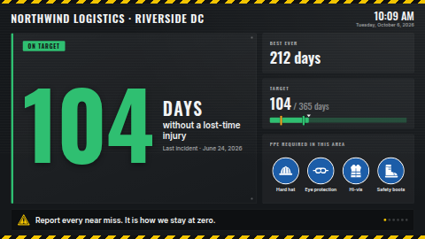

# Days since last incident

A safety streak board for a factory floor, warehouse, depot or building site. A huge count of the
days (or hours, or minutes) since the last incident, coloured by a **green / amber / red** band you
set, sits beside the **best-ever record** and a **target gauge**. Below it is a row of blue
**required-PPE signs** (hard hat, eye protection, hi-vis, gloves, safety boots, ear protection)
and a bar of **rotating safety messages**. On the day of an incident the board turns red, the
plate gets warning stripes, and it says *Incident reported today*.

The count is worked out on the screen itself from the date of the last incident, and it is
rechecked every minute. Nobody has to update it each morning. To reset it, change the date in the
settings, or connect a Google Sheet so a supervisor can type the new date from a phone.

**Kind:** html (code, reviewed). **Network:** none. Nothing is fetched and it works fully offline.

## Settings

| Setting | Type | Default | What it does |
| --- | --- | --- | --- |
| Site name | text (60) | `Northwind Logistics · Riverside DC` | The heading across the top. |
| Date of the last incident | text (32) | `2026-06-24` | `YYYY-MM-DD`, or `YYYY-MM-DD HH:MM` for an exact time (read in the site timezone). `2026-06-24T14:30Z` and `+02:00` offsets work too. A connected data source overrides it. |
| Incident data source | data source | none | Optional. A Google Sheet, CSV or Manual table (see below). |
| Date column | text | `Last incident` | The heading of the column holding the date. Case, spaces and punctuation don't matter. |
| Best-record column | text | `Best record` | Optional column with the best-ever streak in days. It is ignored when the sheet has no such column. |
| Sheet dates like 03/04/2026 are | select | day first | How to read slashed or dotted dates from a sheet (`24/06/2026` or `6/24/2026`). ISO dates (`2026-06-24`) always work. |
| Count in | select | Days | **Days** are calendar days, so the count goes up at midnight in the site timezone. **Days and hours** adds the hours since the incident time (`104 DAYS · 7 HOURS`). **Hours** and **Minutes** are the time elapsed. |
| Unit word | text (24) | empty | Overrides the word under the count. When it's empty, the word comes from the chosen language (*days*, *Tage*, *jours*…). |
| Line under the count | text (80) | `without a lost-time injury` | Empty hides it. |
| Label before the incident date | text (40) | empty | Shown as *Last incident · 24 June 2026*. Empty uses the built-in words in the screen's language. |
| Shown on the day of an incident | text (60) | empty | The red, pulsing status on the day of an incident (built-in: *Incident reported today*). |
| Line under it on that day | text (120) | a short instruction | Replaces the line under the count on that day only. |
| Best-ever record (days) | number | 212 | The site's longest streak. When the current streak passes it, the card shows the current count with a **New record** badge. Set the new record here (or in the sheet) when a streak ends. |
| Heading: best record / Shown when the record is beaten | text | empty | Built-in: *Best ever* / *New record*, in the screen's language. |
| Target (days) | number | 365 | The far end of the gauge. The card reads *104 / 365 days*. |
| Heading: target | text | empty | Built-in: *Target*. |
| Amber from / Green from (days) | number | 30 / 90 | The band: red below *amber from*, amber below *green from*, green from there on. The count, the plate edge, the status chip and the gauge fill take the band colour. The thresholds are marked on the gauge. |
| Status text: green / amber / red | text | empty | The chip at the top of the plate. Empty uses the built-in *On target* / *Building* / *Stay alert* in the screen's language. |
| Safety messages | textarea | six messages | One per line. They fade from one to the next along the bottom. Empty hides the bar. |
| Seconds per message | number 4–120 | 9 | |
| Heading: PPE signs | text (48) | empty | Built-in: *PPE required in this area*. |
| PPE names | text (200) | empty | Six names separated by `\|`, in this order: hard hat, eye protection, hi-vis, gloves, boots, ear protection. An empty name uses the built-in one in the screen's language. |
| Show PPE: … | checkbox × 6 | hard hat, eye protection, hi-vis and boots on | Which signs to show. With none on, the PPE card disappears. |
| Green / Amber / Red colour | colour | `#2FBF71` / `#F5A524` / `#E5383B` | |
| Hazard stripe colour | colour | `#F2C400` | The hazard tape along the edges, the warning sign and the *New record* badge. |
| Background colour | colour | `#15181B` | |
| Clock | select | language default | 24-hour, 12-hour, or hide the clock in the top corner. |
| Site timezone | timezone | the screen's clock | Days roll over at midnight here, and dates without an offset are read in it. Set it whenever the screens and the site might disagree. |
| Language | locale | the screen's language | The built-in words, dates, the clock, thousands separators and the unit words all follow it. |

### When the date is missing or wrong

If the date is empty or can't be read, the count shows `?` in grey and asks you to *Set the date of
the last incident*. A date in the future shows the same, with *The last incident date is in the
future*. The board never invents a streak.

## Resetting it from a Google Sheet

1. Make a sheet with a header row, for example:

   | Last incident | Best record | Notes |
   | --- | --- | --- |
   | 2026-06-24 | 212 | Slip, goods-in, minor |

2. In ScreenTinker, go to *Data sources → New → Google Sheets* (or *Manual table*) and point it at
   the sheet.
3. Choose that source for *Incident data source*. If your headings are different, type them into
   *Date column* and *Best-record column*.

After an incident, the supervisor types the new date into the sheet. When the data source next
syncs, every screen resets to 0 and turns red for the rest of that day.

The sheet can also be a whole **incident log**, one row per incident. The board takes the **most
recent** date in the date column and the **highest** number in the best-record column. Keep the
newest incidents **at the top**. A data source hands a template at most 300 values today, so
only the first rows reach the screen: up to 100 rows for a sheet of one to two columns, about 74 for four
columns. Rows past that limit are never seen. A one-row "status" sheet avoids the limit entirely.
The template also reads **at most 100 rows** (row1 to row100) on its own, so even on a server that
passes more values, rows after the 100th are ignored.

When no data source is connected, or the source has no date column, the typed date is used. So the
board keeps working before the sheet is set up, or if it is unshared.

## Languages

The board speaks English, German, Spanish, French, Hindi, Italian, Japanese, Dutch, Portuguese and
Chinese (Simplified). The **Language** setting picks the language of everything on screen; empty means
the player's own language, and any other language falls back to English.

- The fixed words (status chip, *Best ever*, *Target*, *New record*, *Last incident*, *Incident reported
  today*, the PPE heading and names, the two hints under a grey "?") come from a table in `app.js`. The
  settings that override them are empty by default; a non-empty setting always wins.
- Dates, the clock, numbers and the *days / hours / minutes* words use `Intl` in that language, with
  plural forms from `Intl.PluralRules`.
- `locales/<lang>.json` translates the settings form (name, description, labels, help, options) and
  gives the headline, the note for the day of an incident and the safety messages a translated
  default. The column names and the date stay as they are, so a sheet keeps matching. Servers that
  don't read these files simply ignore them.
- The bundled fonts are Latin only; Japanese, Chinese and Hindi use the player's Noto fonts. Long
  German and Dutch words hyphenate.

## Files

`index.html` (with the PPE pictograms and warning sign drawn as inline SVG, original work), `style.css`,
`app.js`, and `locales/*.json` (settings-form translations). The code is inlined by the server at render time. `fonts/` holds the Oswald and Inter latin
subsets (SIL OFL 1.1, see `NOTICE`).

Licence: MIT (see `LICENSE`); bundled fonts OFL-1.1.
