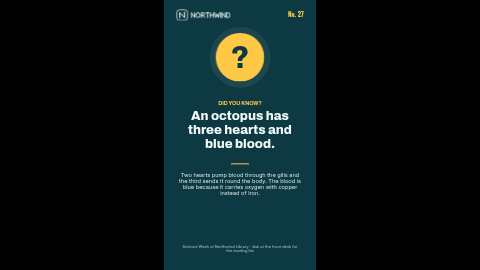

# Did you know? (portrait)

A bold "did you know?" screen: a big character in a bright disc, one surprising sentence as the headline, a short explanation underneath and a footer for the source or the series.

Deep teal background, near-white type and a sunny yellow disc with a soft halo. Laid out in portrait (9:16, for a screen turned on its side). The landscape version is [`did-you-know`](../did-you-know/).

**Kind:** slide (declarative, no code runs). Works on every ScreenTinker player that shows slides,
offline, with no internet access.

## Settings

| Setting | Type | Default | What it does |
| --- | --- | --- | --- |
| Small heading | text (40) | `DID YOU KNOW?` | A small label above the main text, in the accent colour. Capitals read best. |
| Character in the disc | text (3) | `?` | Drawn huge in the disc, in the background colour. One character looks best. |
| Fact number | text (16) | `No. 27` | Top right, e.g. "No. 27". Leave empty to hide. |
| The fact | text (60) | `An octopus has three hearts and blue blood.` | The headline: one short, surprising sentence. |
| Explanation | textarea (200) | (sample text) | One or two sentences that explain it. Enter starts a new line. |
| Footer line | text (90) | (sample text) | A source, a series name or where to find out more. |
| Show the logo | checkbox | on | Off hides the logo and its space stays empty. |
| Logo | image | the bundled `logo.svg` | A PNG or SVG with a transparent background, in a light colour for the default dark background. |
| Accent colour | color | `#FFC845` | The disc, small heading, number and rule. |
| Background colour | color | `#0D3A42` | Behind everything. The character in the disc is drawn in this colour too. |
| Text colour | color | `#F1FAF8` | The fact, explanation and footer. |

## Tips

- Keep the fact to one sentence; the explanation is where the detail goes. Facts that read in five seconds work best on a screen people walk past.
- Check facts before they go up, and name a source in the footer if you can.
- Number your facts ("No. 27") to make it a series people look out for.
- Every element has a fixed place on the slide, so a long text does not push the next block down: it
  runs into it. Stay inside the character limits and preview long text before sending it to screens.
- In a thin strip zone the slide is letterboxed to keep its shape; use a ticker template for strips.

## Languages

The settings page is translated into German, Spanish, French, Hindi, Italian, Japanese, Dutch, Portuguese and Simplified Chinese (`locales/<lang>.json`), and in those languages the
sample texts come translated too, so a new copy starts in the language of the person setting it up.
English in `manifest.json` is the source and the fallback; a server that does not know `locales/`
simply ignores it, and the template works the same.

Every word on screen is one of the settings (the slide adds none of its own), so type them in the
language you want.
Japanese, Chinese and Hindi text is drawn with the player's system fonts, because the bundled fonts
cover Latin scripts only. German runs about a third longer than English: preview long text first.

This is one of the **quotes pack**: `quote-of-the-day`, `did-you-know`, `testimonial` and `safety-tip`, each in a landscape and a `-portrait` version with the same settings, so the same message can run on every screen in the building.

## Files

- `template.json`: the slide (`template` = layout, `fields` = the words), with `{{param:…}}` placeholders
- `logo.svg`: placeholder logo for the fictional "Northwind", original work, MIT (see `NOTICE`)
- `locales/*.json`: the settings page in other languages (see Languages)
- `thumbnail.png`: catalog preview

Licence: MIT (see `LICENSE`).
