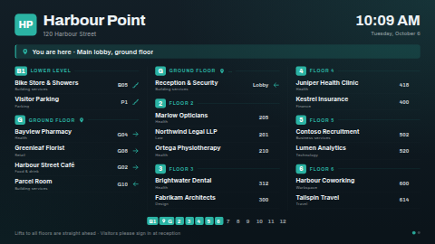

# Building directory

A lobby directory for an office building, a shopping centre or a campus. Every tenant is listed with
its floor and suite, grouped **by floor** (from the lowest floor up, or top floor first),
**A to Z** with letter headings, or **by category**. An index bar along the bottom shows the floors
(or the letters A–Z) and lights up the ones on the current page; the floor this screen is on is
marked with a map pin. Each tenant can have a direction arrow (left, right, up-right…, lifts or
stairs) for the ones you can walk to from here.

The board picks the number of columns and the text size that fill the screen without wrapping
names, in landscape, portrait or a wide strip. A list too long to read on one screen is split into
pages that fade from one to the next, shared evenly so no page is left nearly empty. When a floor
(or letter, or category) carries on into the next column or onto the next page, its heading is
repeated there, marked with `…`, so every tenant has its floor above it.

Type the tenants in, or keep them in a Google Sheet or a Manual table so the front desk can add a
tenant or move a suite without touching the screen.

**Kind:** html (code, reviewed). **Network:** none — nothing is fetched; it works fully offline.

## Settings

| Setting | Type | Default | What it does |
| --- | --- | --- | --- |
| Building name | text (48) | `Harbour Point` | The big heading. |
| Address or subtitle | text (80) | `120 Harbour Street` | One line under the name. Empty hides it. |
| Logo | image | none | Optional, shown beside the name. Without one, the building's initials are shown on an accent-coloured tile (empty building name: no tile). |
| "You are here" line | text (80) | `You are here · Main lobby, ground floor` | A highlighted bar under the header with a map pin. Empty hides it. Not shown in a thin strip. |
| Floor of this screen | text (12) | `G` | Written exactly as in the Floor column (case does not matter). That floor's heading and its index chip get the map pin. Empty: no pin. |
| Arrange by | select | Floor | **Floor**: a heading per floor, tenants A–Z within it. **Name, A to Z**: a heading per first letter, with each tenant's floor shown as a small badge. **Category**: a heading per category, A–Z, tenants with no category last. |
| Floor order | select | Lowest floor first | Or top floor first, like the board beside the lifts. Only used when arranged by floor. |
| Show the index bar | checkbox | on | Floors, letters A–Z or categories along the bottom. Left out automatically when it cannot fit (categories get one line, floors and letters two). Not shown in a thin strip. |
| Show categories under names | checkbox | on | A small second line under each name. Not shown when arranged by category, or in a thin strip. |
| Tenants | textarea (2000) | 33 sample tenants | One per line: `Name \| Floor \| Suite \| Category \| Arrow`. Only the name is required. Used when no data source is connected. |
| Directory data source | data source | none | Optional. A table-shaped source (Google Sheets, CSV, Manual table). When it has the Name column, it replaces the typed tenants. See below. |
| Name / Floor / Suite / Category / Arrow column | text | `Name`, `Floor`, `Suite`, `Category`, `Arrow` | The column headings in your source. Case, spaces and punctuation don't matter (`Suite no.` matches `suite_no`). |
| Floor names | textarea (1000) | `G = Ground floor`, `B1 = Lower level`, `12 = Penthouse` | Optional, one per line: `Floor = Name`. Used as the floor's heading. |
| Word for "floor" | text (20) | empty | Headings of floors without a name read "Floor 7". Empty uses the word in the screen's language ("Etage 7", "7階"). A word you type goes in front of the number; put `{n}` where the number goes (`{n}F`, `Level {n}`). |
| Footer line | text (120) | a note about lifts and signing in | Small print along the bottom. Empty hides it. |
| Text when the list is empty | text (60) | empty | Empty shows "No tenants listed yet" in the screen's language. Shown when the typed list is empty, or a connected sheet has its header but no rows. |
| Clock | select | Language default | 24-hour, 12-hour, or hide the clock and date. |
| Clock timezone | timezone | the screen's | For the clock and date. |
| Language | locale | the screen's | The language of the board's own words, the date and clock, and the language's alphabetical order for sorting names. Letter headings ignore accents (`Ä` is listed under `A`). |
| Accent / Background / Text colour | colour | `#2BB3A3` / `#0E1A22` / `#EEF3F6` | Accent colours the floor badges, headings, arrows and the "you are here" bar. Text on the accent turns dark or white automatically. |
| Seconds per page | number 5–120 | 12 | Only used when the list doesn't fit on one screen. |

### Floors

A floor is whatever you write: `12`, `G`, `B1`, `LG`, `M`, `Level 3`, `Basement 2`, `PH`. They are
put in building order: basements (`B…`, `P…`, `LL`, `Basement`, `Parking`, `Sous-sol`…) at the
bottom, then lower ground, ground (`G`, `GF`, `0`, `Ground`, `Lobby`, `EG`, `RDC`…), mezzanine, the
numbered floors, and penthouse/roof on top. A floor with no number and no known word (`Annex`) is
listed after the others, in the order it first appears. The badge shows a short form (`Level 3` →
`3`, `Basement 2` → `B2`); the heading shows the floor name from *Floor names*, or "Floor 3".

### Arrows

`left`, `right`, `up` (also `ahead`, `straight`), `down` (also `back`), `up-left`, `up-right`,
`down-left`, `down-right` (or the arrow characters ← → ↑ ↓ ↖ ↗ ↙ ↘), `lift` / `elevator`, and
`stairs`. Anything else, or empty, shows no arrow. The arrow column only appears when at least one
tenant has an arrow.

## Using a Google Sheet or a Manual table

1. Make a sheet with a header row: `Name`, `Floor`, `Suite`, `Category`, `Arrow` (any order; leave
   out the ones you don't use).
2. In ScreenTinker, *Data sources → New → Google Sheets* (or *Manual table*) and point it at the sheet.
3. Choose that source for *Directory data source*. If your headings differ, type them into the
   column settings.

The server re-renders the board whenever the source syncs, so edits appear on their own.

**Row limit.** A data source hands an html template at most **300 values** (and 2000 characters per
value) on current servers, and the sheet's cells come row by row. With the five columns above that is
**59 tenants**; with three columns (Name, Floor, Suite) about 98. Every extra column in the sheet
uses up values too, so keep the sheet to the columns this board reads, or point the data source at
a range with just those. A row that the limit cuts in half is left out rather than shown with a
missing floor. The server also passes at most 100 rows of any table, and the board shows at most 200
tenants. If your directory is longer than that, split it across two screens (say, floors 1–10 and
11–20) with two data sources.

**Column headings.** Keep commas out of the headings (`Suite no.` is fine, `Suite, no.` is not),
and give each column a different heading: the server renames a repeated heading (`Name_2`), and the
board only matches the heading you typed.

When no data source is chosen, or the chosen one has no Name column (or has not synced yet), the
typed tenants are shown.

## Languages

The board's own words ("Floor 7" and the empty-list text) come in English, German, Spanish, French,
Hindi, Italian, Japanese, Dutch, Portuguese and Chinese, picked by the *Language* setting (or the
screen's language when it is empty); any other language falls back to English. Dates and the clock
are formatted by the player in that language, and A to Z sorting follows its alphabet. Arrows also
understand the local words (`links`, `derecha`, `escalier`, `左`, `电梯`, `सीढ़ियाँ`…).

`locales/<lang>.json` translates the settings in the dashboard (names, help, options) and gives a
translated sample: a shorter tenant list, floor names, the "You are here" line and the footer.
Older servers ignore these files; the template works the same without them. Column headings for a
data source should use Latin letters: the server turns a heading like `名前` into `col1`.

The bundled fonts are Latin-only; Japanese, Chinese and Hindi text uses the player's Noto (or
system) fonts.

## Files

`index.html`, `style.css`, `app.js` — all inlined by the server at render time. `fonts/` holds the
Archivo and Inter latin subsets (SIL OFL 1.1, see `NOTICE`). The icons (map pin, arrows, lift,
stairs) are drawn in `app.js` as inline SVG.

Licence: MIT (see `LICENSE`); bundled fonts OFL-1.1.
