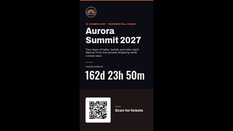

# Event countdown (portrait)

A launch screen for a conference, opening, product launch or sale, laid out for a screen turned on
its side (9:16): the date and venue, the event name and a tagline at the top, a big live countdown
in the middle, and a ticket or RSVP QR code on a tinted panel across the bottom. When the moment
arrives the countdown is replaced by your own message ("Happening now").

The landscape version is [`event-countdown`](../event-countdown/). Both have exactly the same
settings.

**Kind:** slide (declarative, no code runs). Works on every ScreenTinker player that shows slides,
offline, with no internet access. The QR code is drawn by the server; nothing is fetched.

## Settings

| Setting | Type | Default | What it does |
| --- | --- | --- | --- |
| Event name | text (48) | `Aurora Summit 2027` | The big headline. Up to about 26 characters fit on two lines; a third line runs into the tagline. |
| Tagline | text (110) | a one-sentence pitch | Under the name, in lighter type. Three lines at most. |
| Date and venue line | text (60) | `18–19 MARCH 2027 · RIVERSIDE HALL, DUBLIN` | The small accent-coloured line above the name. Plain text: type it the way you want it to read. |
| Count down to | text (40) | `2027-03-18T09:00:00+00:00` | The moment the countdown reaches zero. **Format below.** |
| Label above the countdown | text (40) | `DOORS OPEN IN` | Small caption over the numbers. It stays after the countdown ends, so pick words that still read well then (or clear it on the day). |
| Shown when the countdown ends | text (24) | `Happening now` | Replaces the numbers once the target has passed. |
| Language | locale | empty = the screen's language | Language of the countdown units on servers that localise them; older servers show `d h m s`. |
| Show the ticket QR code | checkbox | on | Off hides the code, its white card, caption and rule (the tinted panel stays). |
| Ticket / RSVP link | text (300) | `https://example.com/aurora/tickets` | What the QR opens. Shorter links give a coarser code that scans from further away. |
| QR caption | text (32) | `Scan for tickets` | To the right of the code. Two lines at most. |
| Logo | image | the bundled placeholder `logo.svg` | Top left, in a square box. A transparent PNG or SVG works best. |
| Background photo | image | none | Optional hero or venue photo behind everything. A portrait-shaped photo crops least. |
| Darken the photo | number 0–0.9 | `0.6` | A black scrim over the photo so the text stays legible. Ignored without a photo. |
| Accent / Background / Text colour | colour | `#FF7A45` / `#0B0C14` / `#F6F3EE` | The accent colours the date line, rules, top bar and the panel tint. |

### The countdown target format

Use **ISO 8601 with a timezone offset**:

- `2027-03-18T09:00:00+00:00`: 09:00 in London (winter), or write `2027-03-18T09:00:00Z`
- `2027-03-18T09:00:00-04:00`: 09:00 in New York during daylight saving time
- `2027-03-18T09:00:00+01:00`: 09:00 in Paris (winter)

The offset is the one **in force on the event date** (summer time included). Without an offset
(`2027-03-18T09:00`) the time is read in the **ScreenTinker server's** timezone, which is often UTC
and rarely what you meant. A date on its own (`2027-03-18`) means midnight UTC. A plain number is
also accepted and read as milliseconds since 1970 (UTC).

An empty or unreadable value leaves the countdown blank (nothing breaks). The numbers read `162d 23h
50m` while days remain, then `5h 12m 30s`, then `4m 05s`. That format is fixed by the player's slide
renderer (newer servers write the units in the **Language** setting's language), so there is no "show seconds" switch: seconds appear on their own in the last day. The
countdown runs on each screen's own clock, so keep your players' time in sync (NTP).

## Tips

- Every element has a fixed place on the slide, so long text does not push the next block down: it
  overlaps it. Keep the event name short and put the rest in the tagline.
- With the QR code turned off, the bottom panel stays as a plain tinted band.
- Test the QR with a phone before the event: point it at the screen from where people will stand.
- On a landscape screen or a strip zone the slide is letterboxed to keep its shape. Use
  `event-countdown` for landscape screens.

## Languages

The dashboard shows this template's name, description and every setting's label and help in English, German,
Spanish, French, Hindi, Italian, Japanese, Dutch, Portuguese and Chinese (`locales/<lang>.json`; a
server without translation support simply shows English). The sample texts (tagline, date and venue line, countdown
label, end message, QR caption) are translated too and sized for the same layout; the event name and
venue are names and stay as typed. The **Language** setting (empty = the screen's language) is passed
to the countdown so a ScreenTinker server with localised countdowns shows the units in that language;
older servers always show `d h m s`. The slide renderer's bundled fonts cover Latin; Japanese, Chinese and Hindi fall back to the screen's own
fonts (Noto on ScreenTinker players).

## Files

- `template.json`: the slide (`template` = layout, `fields` = the words), with `{{param:…}}` placeholders
- `logo.svg`: placeholder mark for the fictional "Aurora Summit", original work, MIT (see `NOTICE`)
- `thumbnail.png`: catalog preview

Licence: MIT (see `LICENSE`).
