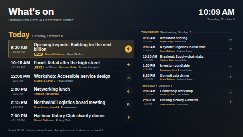

# What's on — events agenda

A "What's on" board for a hotel function board, a conference session board, a campus, library,
church or community-centre lobby. It lists the next events grouped by day: **today** (or, from the
evening on, **tonight**) is large, and the following days are listed smaller beside it in landscape
or below it in portrait. Each event shows its time, title, room or location, host or speaker, and
an optional **direction arrow** (← ↑ → ↓ ↖ ↗ ↘ ↙) so people know which way to walk.

- The session **in progress** is highlighted with a *Now* tag and a progress bar.
- The next session today gets a *Next* tag and "in 25 min" (in the board's language).
- **Finished events drop off by themselves**, worked out on the screen every 15 seconds, so the
  board never shows a session that has already ended, even between data-source syncs.
- When there are more events than fit at a readable size, each column **pages**, fading between
  pages, with dots in the footer.
- In a thin strip zone (wider than about 3.2:1) it shows the next events as a row of cards.

**Kind:** html (code, reviewed). **Network:** none. The page fetches nothing; the ScreenTinker
server reads the calendar or sheet and hands the values to the page when it renders.



## Settings

| Setting | Type | Default | What it does |
| --- | --- | --- | --- |
| Title | text (48) | `What's on` | The big heading. Empty hides it. |
| Subtitle | text (80) | `Harbourview Hotel & Conference Centre` | One line under the title. Empty hides it. |
| Footer line | text (120) | a Wi-Fi note | Small print along the bottom. Empty hides it. |
| Logo | image | none | Optional, shown beside the title. |
| Programme | textarea | a sample conference and hotel day | The events, one per line (see below). Used when no data source is connected, or when the connected one is not an events source. |
| Events data source | data source | none | Optional. A **Calendar (iCal)** source, or a **Google Sheet / CSV / Manual table** with the columns below. |
| Sheet column: date / start time / end time / title / location / host or speaker / direction arrow | text | `Date`, `Start`, `End`, `Title`, `Location`, `Host`, `Arrow` | The column headings in your sheet. Case, spaces and punctuation don't matter (`Start time` matches `start_time`). Not used for iCal. |
| Days to show | number 1–14 | 3 | Today plus the following days. `1` shows today only. |
| Most events per page | number 2–20 | 8 | Per column. Fewer are shown when they would not fit at a readable size; the rest page. |
| Seconds per page | number 5–120 | 12 | Only used when there is more than one page. |
| Say Tonight in the evening | checkbox | on | Off keeps saying Today all day. |
| "Tonight" from (hour) | number 12–23 | 17 | From this hour (venue time) the first day is headed with the Tonight text. |
| Text: Today / Tonight / Tomorrow | text (24) | empty | Empty uses the built-in word in the board's language (`Today`, `Heute`, `Aujourd’hui`…). |
| Tag the next session today | checkbox | on | The Next tag and "in 25 min" on the next session today. |
| Text: Now / Next / All day | text (16) | empty | The tags. Empty uses the built-in words (`Now`, `Next`, `All day` in English). |
| Text when nothing is scheduled | text (80) | empty | Shown, with the day, when no events are left in the window. Empty uses the built-in text. |
| Times | choice | language default | 24-hour or 12-hour, for the clock and the event times. |
| Show the clock and date | checkbox | on | The clock top right. |
| Timezone | timezone | the screen's | The venue's timezone: used for the clock, for "today", and to read the times typed in a sheet or the programme. |
| Language | locale | the screen's | The board's built-in words, weekday and month names, times and "in 25 min" (see *Languages*). |
| Accent / Background / Text colour | colour | `#E9B44C` / `#0C1522` / `#F3F5F8` | The accent colours the day names, rooms, tags, arrows and the highlight. |

## The programme box (and sheet rows)

One event per line, seven fields separated by `|`:

```
Date | Start | End | Title | Location | Host | Arrow
+0   | 09:30 | 10:30 | Opening keynote | Grand Ballroom | Maya Okafor | ↑
2026-10-12 | 7pm | 11pm | Charity dinner | Terrace | Rotary Club | right
```

- **Date**: `2026-10-12`, `12/10/2026` (day and month order follows the language setting when both
  are 12 or less), or a day offset: `+0` (or empty) is today, `+1` tomorrow, `+2` the day after.
  Offsets make a programme that repeats every day, and they are what the sample uses so it always
  looks current.
- **Start / End**: `09:30`, `9.30`, `21:00`, `9am`, `7:30 pm`. No end time shows the start only (the
  event then counts as one hour long for the highlight). No start time makes it an **all-day** event.
  An end earlier than the start means the event runs past midnight. A start cell may also hold a
  full date and time (`2026-10-12T09:30`, with or without an offset), and the date column is then
  not needed.
- **Location**, **Host** and **Arrow** are optional. Arrow takes a symbol (← ↑ → ↓ ↖ ↗ ↘ ↙) or a word:
  `left`, `right`, `ahead`/`up`/`straight`, `down`/`back`, `up-left`, `up-right`, `down-left`,
  `down-right`. When no event has an arrow, the arrow column disappears.
- Events are sorted by start time; a line without a title is skipped.

Times typed here or in a sheet are read as **venue time** in the Timezone setting.

## Using a Google Sheet or Manual table

1. Make a sheet with a header row: `Date`, `Start`, `End`, `Title`, `Location`, `Host`, `Arrow`,
   one event per row, in the formats above.
2. In ScreenTinker, *Data sources → New → Google Sheets* (or CSV, or Manual table) and point it at
   the sheet.
3. Choose that source for *Events data source*. If your headings differ, type them into the
   *Sheet column* settings. Headings in any script work (`日付`, `तारीख़`): they are matched by
   name, and the English heading (`Date`, `Start`…) is always tried as well, so an English sheet
   keeps working when the settings were filled in another language.

A table source reaches the template as `row1_title`, `row1_start`, … (`row_count`, `columns`).
**Row limit:** today a data source hands an html template at most **300 values**, so with all seven
columns about **42 rows** arrive (fewer columns, more rows). Past events in the sheet still count
toward that, so remove old rows from time to time, or keep a sheet per week.

## Using a calendar (iCal)

1. *Data sources → New → Calendar (iCal)*, paste the calendar's iCal (`.ics`) address — a Google
   Calendar "secret address in iCal format", a published Outlook / Microsoft 365 calendar, or any
   `.ics` URL.
2. On the data source, set **look-ahead days** to at least *Days to show*, **max events** to about
   30, and its **timezone** to the venue's (the same as this board's *Timezone*). Its language does
   not matter: the board re-words the server's day names and times in its own *Language*.
3. Choose it for *Events data source*.

Keys read: `event_count`, `events_today_count`, and per event `event_N_title`, `event_N_location`,
`event_N_organizer`. When the server provides `event_N_start_iso`, `event_N_end_iso` and
`event_N_all_day`, the board uses those exact times (formatted in your language and timezone,
past events dropped on the screen). On servers that do not provide them yet (every released
server so far), it reads the server's own `event_N_date` / `event_N_time` text back into days and
times — "Today", "Tomorrow" and the short date ("Thu, Oct 8", "Do., 8. Okt.") in any of the ten
languages the server speaks, 12- or 24-hour times — and then shows them like any other event, in
the board's language and clock format. Text it cannot read is shown as written, grouped by the
server's day label. A private event's masked title ("Busy") becomes "Private event" in the board's
language. Organisers that are only an e-mail
address are not shown. About 30–45 events arrive under the 300-value limit described above.

If the bound source is neither a calendar nor a table with a Title column (for example a source
that has not synced yet), the typed programme is shown instead of an empty board.

## Languages

- **On the board.** The *Language* setting (empty = the player's own language) picks the built-in
  words — Today, Tonight, Tomorrow, Now, Next, All day, Nothing else scheduled — in English,
  German, Spanish, French, Hindi, Italian, Japanese, Dutch, Portuguese and Simplified Chinese (by
  the first part of the tag, so `de-AT` gets German). For any other language, Today and Tomorrow
  come from the browser's `Intl` data and the other words fall back to English. Weekdays, months,
  times and "in 25 min" are always formatted by `Intl` in that language. A word typed into a
  setting wins over the built-in one. Calendar days and times are re-worded into this language
  too, whatever language the Calendar data source is set to (see *Using a calendar*).
- **In the dashboard.** `locales/<lang>.json` translates the name, description and every setting
  for de, es, fr, hi, it, ja, nl, pt and zh, with translated defaults for the title, subtitle,
  footer, sheet column headings and a translated sample programme. Each package file must keep its
  lines under 400 characters, so the translated sample is a shorter pick (4–8 events) of the
  English one. Servers that do not know these files ignore them; the template works the same.
- Arrow words in a sheet or the programme (`left`, `right`, `up`…) are English only; the arrow
  symbols work everywhere.
- The page sets its `lang` attribute from the language, so long German words hyphenate and
  Chinese/Japanese break lines correctly. The bundled fonts are Latin-only; Chinese, Japanese and
  Devanagari text uses the player's Noto fonts (`Noto Sans CJK`, `Noto Sans Devanagari`).

## Files

`index.html`, `style.css`, `app.js` — inlined by the server at render time. `fonts/` holds the
Archivo and Inter latin subsets (SIL OFL 1.1, see `NOTICE`). The arrows are inline SVG drawn by
`app.js`.

Licence: MIT (see `LICENSE`); bundled fonts OFL-1.1.
