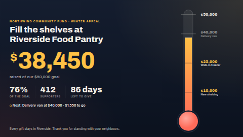

# Goal progress

A fundraising thermometer for the screen in the hall, the lobby or the sales floor. It shows how much
has been raised against the goal as a **thermometer**, a **progress bar** or a **ring**, with the
percentage, milestones along the gauge, the number of supporters, a countdown to the deadline, a
headline and a thank-you line. When the goal is reached it says so, glows, and drops a short shower
of confetti every couple of minutes.

Type the total in and change it when you like, or connect a data source (a Google Sheet, the
responses sheet of a donation form, a CSV, a REST API or a Manual table) and the screen updates
itself whenever the source syncs.

Made for nonprofits, churches, schools and PTAs (in money, or in books read, hours volunteered,
cans collected) and for sales teams chasing a quarterly target.

**Kind:** html (code, reviewed). **Network:** none. Nothing is fetched; it works fully offline.

## Settings

| Setting | Type | Default | What it does |
| --- | --- | --- | --- |
| Headline | text (90) | `Fill the shelves at Riverside Food Pantry` | The big line, up to three lines; long text shrinks to fit. |
| Campaign name | text (80) | `Northwind Community Fund · Winter Appeal` | Small coloured line above the headline. Empty hides it. |
| Thank-you line | text (140) | a thank-you | Along the bottom. Empty hides it. |
| Logo | image | none | Optional, above the headline. |
| Gauge | select | Thermometer | Thermometer, Progress bar or Ring. A wide strip zone always draws the bar. |
| Amount raised so far | number | `38450` | The total, when no data source supplies one. |
| Goal | number | `50000` | The target. `0` shows the amount without a gauge position or percentage. |
| Number of supporters | number | `412` | `0` hides it. |
| Currency code | text (3) | `USD` | An ISO 4217 code (`USD`, `EUR`, `GBP`, `CAD`, `AUD`, `JPY`…), formatted the local way for the chosen language (`$38,450`, `38.450 €`). Empty gives plain numbers. |
| Unit | text (24) | empty | With no currency, shown after the numbers: `1,240 books`, `318 hours`. |
| Show cents / decimals | checkbox | off | `$38,450.50` instead of `$38,451`. |
| Milestones | textarea | three | One per line, `Amount \| Label`, e.g. `25000 \| Walk-in freezer`. Up to 10, between 0 and the goal; others are ignored. Reached ones light up. A milestone at exactly the goal names the goal mark. |
| Deadline | text (20) | `year-end` | `2026-12-24` (the end of that day), `2026-12-24T17:00`, or a rolling `month-end`, `quarter-end` or `year-end`. Empty hides the countdown. |
| Timezone of the deadline | timezone | the screen's | The zone the deadline is read in. |
| Language | locale | the screen's | `en-US`, `de-DE`, `fr-CA`… Controls the built-in words and the number, currency, percentage and "86 days" formatting. |
| Text under the amount | text (80) | empty | `{target}` becomes the formatted goal. Empty uses the built-in *raised of our {target} goal* in the screen's language; `-` hides it. |
| Caption: percentage / supporters / countdown | text (30) | empty | The small captions under the three figures. Empty uses the built-in *of the goal*, *supporter(s)*, *left to give*; `-` hides one. |
| Text once the deadline has passed | text (30) | empty | Replaces the countdown. Empty uses the built-in *Appeal closed*; `-` hides it. |
| Next-milestone line | text (100) | empty | Shown while a milestone is still ahead. Empty uses the built-in *Next: {milestone} at {amount} · {remaining} to go*; `-` hides it. |
| Text when the goal is reached | text (60) | empty | The badge above the headline once the total reaches the goal (built-in: *Goal reached. Thank you!*; `-` hides it). |
| Live total data source | data source | none | Optional; see below. |
| Amount column or field | text | `Raised` | Where the total is in the source. |
| How to read the amount | select | Automatic | See below. |
| Goal column or field | text | `Target` | Optional. When present it overrides the Goal setting. |
| Supporters column or field | text | `Supporters` | Optional. When present it overrides the supporter count. |
| Heading font | select | Archivo | Archivo, Bitter, Oswald or Inter for the headline and figures. |
| Accent / Second fill / Background / Text colour | colour | `#FFC145` / `#FF6B5A` / `#10192B` / `#F6F1E9` | The fill fades from the second colour into the accent. |
| Animate | checkbox | on | The gauge fills and the amount counts up when the page loads; confetti at the goal. Off for very slow players. |

## Languages

The screen speaks English, German, Spanish, French, Hindi, Italian, Japanese, Dutch, Portuguese and
Chinese (Simplified). The **Language** setting picks it; empty means the player's own language, and any
other language falls back to English.

- The fixed words (the line under the amount, the three captions, the next-milestone line, *Appeal
  closed*, *Goal reached*) come from a table in `app.js`. The settings that override them are empty by
  default; a non-empty setting always wins and `-` hides that line. *supporter / supporters* follows
  `Intl.PluralRules`.
- Money, numbers, percentages and the countdown (*86 days*) are formatted with `Intl` in that language.
- `locales/<lang>.json` translates the settings form and gives the headline, campaign line, thank-you
  line and milestones a translated default, plus a local currency (EUR, BRL, JPY, CNY, INR). The column
  names and `year-end` stay as they are. Servers that don't read these files simply ignore them.
- The bundled fonts are Latin only; Japanese, Chinese and Hindi use the player's Noto fonts. Long
  German and Dutch words hyphenate.

## Connecting a data source

Column and field names are matched the way ScreenTinker names them: case, spaces and punctuation do
not matter (`Amount raised` matches `amount_raised`). If the source has no amount column the
typed-in numbers are used, so a misconfigured source never blanks the screen.

**A sheet with the total in it** (the simplest one). One header row and one data row:

| Raised | Target | Supporters |
| --- | --- | --- |
| 38450 | 50000 | 412 |

Leave *How to read the amount* on **Automatic** (one row is the total). Update the cell; the screen
follows on the next sync.

**A donations log** (a Google Form's responses sheet, a payment export). One row per gift with an
`Amount` column: set *Amount column* to `Amount` and leave **Automatic** (or choose **Add up every
row**). The total is the sum of the column, worked out by the server across the whole sheet, and
the supporter count becomes the number of rows unless the sheet also has a Supporters column.

**A running total**: one row per day or week with the cumulative figure. Choose **Last row**.

**A key/value sheet** (`Key | Value` rows: `Raised | 38450`, `Target | 50000`) in lookup mode with
`Key` as the key column, or **a REST API** returning an object such as
`{"raised": 38450, "target": 50000, "supporters": 412}`: the field is read directly. A nested field
like `{"totals": {"raised": …}}` is named `totals_raised`.

Amounts may include currency signs and thousands separators (`$38,450`, `38.450,00 €`).

### Limits

The server currently hands an html template at most **300 values per data source** (and 2000
characters per value). For a donations log that means the server's own column total is always used
when it reaches the template, but a log with many columns and more than roughly 100 rows can push
that total past the limit, and the template then adds up only the rows it was given. For a long log,
keep the total in a cell instead (a `=SUM()` row in its own small sheet, or lookup mode) and point the
template at that. A table data source passes at most 100 rows in any case.

## The deadline

The countdown shows whole days while two or more remain, then hours, then minutes, and refreshes
itself every minute. A bare date counts to midnight at the end of that day in the chosen timezone.
`year-end` always counts to the coming 1 January, so a recurring year-end appeal never needs editing.

## Files

`index.html`, `style.css`, `app.js` are inlined by the server at render time; `locales/*.json` translate the settings form. `fonts/` holds the
Archivo, Bitter, Inter and Oswald latin subsets (SIL OFL 1.1, see `NOTICE`). The gauges, confetti and
everything else are CSS and SVG drawn by the template.

Licence: MIT (see `LICENSE`); bundled fonts OFL-1.1.
