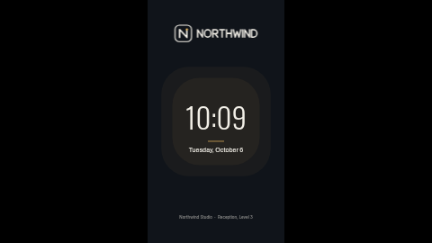

# Holding screen — logo and clock (portrait)

A standby screen for when nothing is scheduled: your logo, a big live clock and today's date on a calm background with a soft halo, in your own timezone and language. Keeps a screen looking cared for between campaigns.

Laid out in portrait (9:16). The landscape version is [`holding-logo-clock`](../holding-logo-clock/), with the same settings.

**Kind:** slide (declarative, no code runs). Works on every ScreenTinker player that shows slides,
offline, with no internet access and no data source to set up.

## Settings

| Setting | Type | Default | What it does |
| --- | --- | --- | --- |
| Logo | image | the bundled placeholder `logo.svg` | Centred at the top. A wide, light logo with a transparent background works best (the box is about 2.7:1 landscape, 8.5:1 portrait); a square one sits centred in it. |
| Footer line | text (80) | `Northwind Studio  ·  Reception, Level 3` | One line along the bottom. Empty hides it. |
| Clock format | select | 24-hour | 24-hour or 12-hour (12-hour adds AM/PM in the screen's language). |
| Date style | select | Weekday, day and month | Weekday + day + month, full date with year, short date, or numbers only. |
| Timezone | timezone | empty = the screen's clock | Which timezone the clock and date show. |
| Language | locale | empty = the screen's language | How the time and date are written (`en-GB`, `de-DE`, `fr-CA` …). Month and weekday names come from the screen, never from the template. |
| Accent colour | colour | `#E0B25C` | The soft halo behind the clock and the rule under it. |
| Background colour | colour | `#10141A` | The page. |
| Text colour | colour | `#F3F0E8` | Clock, date and footer. |

## Using it as a screen's holding screen

A holding screen is what a display shows when nothing else is booked for it. There are two ways to
set that up, and which one fits depends on what you want on the screen:

1. **As the screen's base playlist (recommended — keeps the live clock).** Create the widget from
   this template (*Content → Templates → Library → Holding screen — logo and clock (portrait) → Create widget*), add it to a
   playlist called something like *Standby*, publish that playlist, and assign it to the screen
   (or to a group of screens) as its playlist. When a campaign starts, assign or schedule the
   campaign playlist for its dates; when it ends, the screen goes back to *Standby* rather than
   to a blank "Waiting…" screen.
2. **As the screen's Default Content (a still picture only).** The *Default Content* setting on a
   screen's page picks a **file from your content library**, and players show it only when the
   screen has no playlist or every item is outside its schedule. It accepts **images only** — a
   widget such as this template cannot be chosen there, and a live clock cannot be frozen into one.
   If you want this look as Default Content, take a screenshot of the template preview, upload it as
   an image and choose that; it will not tick.

If you put this widget in the *same* playlist as campaign items, it plays in turn with them like any
other item — it does not wait for the others to end. Use a separate *Standby* playlist for
"only when nothing else is on".

## Tips

- Every element has a fixed place on the slide, so long text does not push the next block down; it
  overlaps it. Stay inside the character limits and preview long text before putting it on screens.
- On a landscape screen use [`holding-logo-clock`](../holding-logo-clock/); this one would be letterboxed.
- In a thin strip zone the slide is letterboxed to keep its shape (a small card in the middle of the
  strip with black bars either side). Use a ticker template for strips.
- The clock and date are formatted by the screen itself with `Intl` in the language you choose, so
  they are correct in any language the panel supports and need no translation.

This is one of the **holding-screen pack**: `holding-logo-clock`, `holding-logo-message` and
`holding-gradient-time`, each in a landscape and a `-portrait` version with the same settings.

## Languages

The dashboard shows this template's name, description and settings in German, Spanish, French,
Hindi, Italian, Japanese, Dutch, Portuguese and Chinese (the files in `locales/`; English lives in
`manifest.json` and is the fallback). In those languages the text settings also come with a
translated example, written to fit this layout. Servers without translation support ignore
`locales/` and show the English.

On screen, every word is a setting you type in your own language. The only text the slide makes up
itself is the time and the date, and those follow **Language** (empty = the screen's language),
including month and weekday names and the AM/PM marker of the 12-hour clock.

The bundled fonts (Oswald, Archivo, Inter) cover Latin scripts. Japanese, Chinese and Hindi are drawn with the
player's own fonts, so check one screen first: Android, Fire TV, Windows, ChromeOS, macOS, Tizen and
webOS have them; a minimal Linux image may need the Noto CJK and Devanagari fonts installed.

## Files

- `template.json`: the slide (`template` = layout, `fields` = the words), with `{{param:…}}` placeholders
- `logo.svg`: placeholder mark for the fictional "Northwind", original work, MIT (see `NOTICE`)
- `thumbnail.png`: catalog preview
- `locales/<lang>.json`: dashboard translations (de, es, fr, hi, it, ja, nl, pt, zh)

Licence: MIT (see `LICENSE`).
