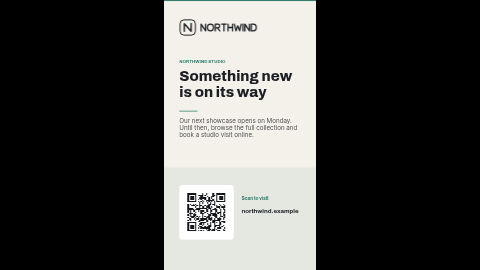

# Holding screen — logo, message and website (portrait)

A branded "back soon" screen for between campaigns: your logo, a short message and a line of detail, your website in large type and an optional QR code that opens it. Nothing is fetched; the code is drawn by the server.

Laid out in portrait (9:16). The landscape version is [`holding-logo-message`](../holding-logo-message/), with the same settings.

**Kind:** slide (declarative, no code runs). Works on every ScreenTinker player that shows slides,
offline, with no internet access and no data source to set up.

## Settings

| Setting | Type | Default | What it does |
| --- | --- | --- | --- |
| Logo | image | the bundled placeholder `logo.svg` | Top left. A transparent PNG or SVG works best; the placeholder is dark ink for the light default background. |
| Small heading | text (40) | `NORTHWIND STUDIO` | Label above the message, in the accent colour. |
| Message | text (50) | `Something new is on its way` | The main line. Up to about 40 characters sits on two lines; longer text runs into the detail. |
| Detail | textarea (140) | two short sentences | Under the message. Enter starts a new line. |
| Website line | text (40) | `northwind.example` | Your address in large type, bottom left (landscape) or beside the code (portrait). Plain text: type it the way it should read. |
| Show a QR code | checkbox | on | Off hides the code, its white card and its caption; the space stays as a calm panel. |
| QR code link | text (300) | `https://example.com/northwind` | What the code opens. Drawn by the server, nothing is fetched. |
| QR caption | text (28) | `Scan to visit` | Under (landscape) or beside (portrait) the code. |
| Accent colour | colour | `#2F7D6D` | Small heading, the rules and the tinted panel behind the code. |
| Background colour | colour | `#F4F1EA` | The page. |
| Text colour | colour | `#1B1E24` | Message, detail, website and caption. |

## Using it as a screen's holding screen

A holding screen is what a display shows when nothing else is booked for it. There are two ways to
set that up, and which one fits depends on what you want on the screen:

1. **As the screen's base playlist (recommended — keeps the live clock).** Create the widget from
   this template (*Content → Templates → Library → Holding screen — logo, message and website (portrait) → Create widget*), add it to a
   playlist called something like *Standby*, publish that playlist, and assign it to the screen
   (or to a group of screens) as its playlist. When a campaign starts, assign or schedule the
   campaign playlist for its dates; when it ends, the screen goes back to *Standby* rather than
   to a blank "Waiting…" screen.
2. **As the screen's Default Content (a still picture only).** The *Default Content* setting on a
   screen's page picks a **file from your content library**, and players show it only when the
   screen has no playlist or every item is outside its schedule. It accepts **images only** — a
   widget such as this template cannot be chosen there, and a live clock cannot be frozen into one.
   If you want this look as Default Content, take a screenshot of the template preview, upload it as
   an image and choose that; it will not tick.

If you put this widget in the *same* playlist as campaign items, it plays in turn with them like any
other item — it does not wait for the others to end. Use a separate *Standby* playlist for
"only when nothing else is on".

## Tips

- Every element has a fixed place on the slide, so long text does not push the next block down; it
  overlaps it. Stay inside the character limits and preview long text before putting it on screens.
- On a landscape screen use [`holding-logo-message`](../holding-logo-message/); this one would be letterboxed.
- In a thin strip zone the slide is letterboxed to keep its shape (a small card in the middle of the
  strip with black bars either side). Use a ticker template for strips.
- The clock and date are formatted by the screen itself with `Intl` in the language you choose, so
  they are correct in any language the panel supports and need no translation.

This is one of the **holding-screen pack**: `holding-logo-clock`, `holding-logo-message` and
`holding-gradient-time`, each in a landscape and a `-portrait` version with the same settings.

## Languages

The dashboard shows this template's name, description and settings in German, Spanish, French,
Hindi, Italian, Japanese, Dutch, Portuguese and Chinese (the files in `locales/`; English lives in
`manifest.json` and is the fallback). In those languages the text settings also come with a
translated example, written to fit this layout (the small heading and the website keep the brand name and address as they are). Servers without translation support ignore
`locales/` and show the English.

On screen, every word is a setting you type in your own language. The slide makes up no words of its own: this
design has no clock or date.

The bundled fonts (Archivo, Inter) cover Latin scripts. Japanese, Chinese and Hindi are drawn with the
player's own fonts, so check one screen first: Android, Fire TV, Windows, ChromeOS, macOS, Tizen and
webOS have them; a minimal Linux image may need the Noto CJK and Devanagari fonts installed.

## Files

- `template.json`: the slide (`template` = layout, `fields` = the words), with `{{param:…}}` placeholders
- `logo.svg`: placeholder mark for the fictional "Northwind", original work, MIT (see `NOTICE`)
- `thumbnail.png`: catalog preview
- `locales/<lang>.json`: dashboard translations (de, es, fr, hi, it, ja, nl, pt, zh)

Licence: MIT (see `LICENSE`).
