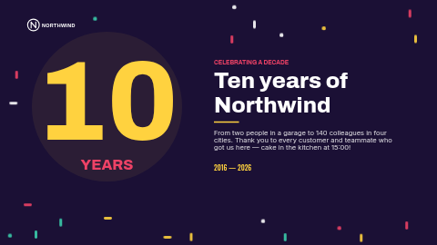

# Celebrate

A confetti celebration for any occasion — a company anniversary, a birthday, a record month, a grand opening or a team win: a giant number, a headline, a message and a date line, in colours you choose.

Part of the ScreenTinker **holiday pack**: eight greeting slides (New Year, Valentine's Day, Earth Day,
Thank-you day, Halloween, Thanksgiving & harvest, Winter holidays and Celebrate), each in a landscape
and a portrait version. This is the **landscape (16:9)** version; for portrait screens use `holiday-celebrate-portrait`.

**Kind:** slide (declarative — no code runs). Works on every ScreenTinker player that shows slides,
with no internet access needed. All decoration is drawn from the slide renderer's own shapes (no
images, emoji or fonts that a player might lack), so it looks the same on every screen and recolours
with the colour settings.

## Settings

| Setting | Type | Default | Notes |
| --- | --- | --- | --- |
| Small heading | text (40) | `CELEBRATING A DECADE` | The short line above the headline. Leave empty to hide it. |
| Headline | text (28) | `Ten years of Northwind` | Two lines are kept for it: about 24 characters fit. Longer headlines wrap to a third line and run into the message. |
| Message | textarea (200) | sample text (see the preview) | A sentence or two under the headline; up to 200 characters fit. A line break starts a new line. |
| Date line | text (70) | `2016 — 2026` | Plain text, typed the way you want it to read: a date, a time and place, or a sign-off. |
| Show the logo | checkbox | on | Turn off if you have no logo. |
| Logo | image | the bundled Northwind placeholder `logo.svg` | A wide PNG or SVG with a transparent background (about 3.4 : 1 fills the box; other shapes are fitted inside it). Replace the Northwind placeholder. |
| Number colour | color | `#FFD23F` |  |
| Second accent colour | color | `#EE4266` |  |
| Background colour | color | `#1B1035` |  |
| Text colour | color | `#FFFFFF` |  |
| Big number | text (4) | `10` | The giant figure: years, a birthday, a percentage, a rank. Up to four characters; clear it for none. |
| Under the number | text (16) | `YEARS` | A word under the big number, such as YEARS or DAYS. |

The two accent colours drive the decoration as well as the small heading, rule and date line, so a
brand colour swap restyles the whole slide. Keep enough contrast between the text and background
colours for the screen to read from across a room.

## Tips

- Every text is plain text: type the date line exactly as it should read (`31 · 10`, `Friday 3pm`,
  `Open until 21:00`) in your own language.
- The headline always has two lines of room: about 24 characters fit (the field stops at 28). A
  longer headline wraps to a third line and runs into the message, so keep it short.
- The message has room for 200 characters (the field's limit) without touching the date line. Each line break you
  type uses up a line of that room.
- The slide is laid out at 16:9. In a zone of another shape the player letterboxes it rather than
  stretching it; in a thin strip it shrinks to fit, so use a dedicated ticker for strips.
- Empty fields simply disappear, so you can clear the small heading or date line.

## Languages

The dashboard shows this template's name, description, setting labels and help in English, German,
Spanish, French, Hindi, Italian, Japanese, Dutch, Portuguese and Chinese (`locales/<lang>.json`; a
server without translation support simply shows English). The sample texts are translated too: in
another dashboard language the headline, message and other texts start out in that language, sized to
fit the same layout. In Japanese and Chinese each character is a full em wide, so about 8 headline
characters fit per line and about 90 message characters in all.
Everything on the slide is text you type, so it can be in any language; the slide renderer's fonts
fall back to the screen's own fonts for scripts they do not cover (CJK, Devanagari).

## Files

- `template.json` — the slide (`template` = layout, `fields` = the words), with `{{param:…}}` placeholders
- `locales/<lang>.json` — dashboard translations (name, description, settings, sample texts)
- `logo.svg` — placeholder wordmark for the fictional Northwind, original work, MIT (see `NOTICE`)
- `thumbnail.png` — catalog preview

Licence: MIT (see `LICENSE`).
