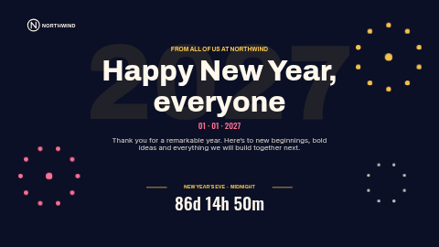

# New Year

A midnight-blue New Year greeting with gold and pink fireworks drawn from dots, the coming year in giant type behind the headline, and an optional live countdown to midnight that switches to your own message when the year turns.

Part of the ScreenTinker **holiday pack**: eight greeting slides (New Year, Valentine's Day, Earth Day,
Thank-you day, Halloween, Thanksgiving & harvest, Winter holidays and Celebrate), each in a landscape
and a portrait version. This is the **landscape (16:9)** version; for portrait screens use `holiday-new-year-portrait`.

**Kind:** slide (declarative — no code runs). Works on every ScreenTinker player that shows slides,
with no internet access needed. All decoration is drawn from the slide renderer's own shapes (no
images, emoji or fonts that a player might lack), so it looks the same on every screen and recolours
with the colour settings.

## Settings

| Setting | Type | Default | Notes |
| --- | --- | --- | --- |
| Small heading | text (40) | `FROM ALL OF US AT NORTHWIND` | The short line above the headline. Leave empty to hide it. |
| Headline | text (28) | `Happy New Year, everyone` | Two lines are kept for it: about 24 characters fit. Longer headlines wrap to a third line and run into the message. |
| Message | textarea (200) | sample text (see the preview) | A sentence or two under the headline; up to 200 characters fit. A line break starts a new line. |
| Date line | text (70) | `01 · 01 · 2027` | Plain text, typed the way you want it to read: a date, a time and place, or a sign-off. |
| Show the logo | checkbox | on | Turn off if you have no logo. |
| Logo | image | the bundled Northwind placeholder `logo.svg` | A wide PNG or SVG with a transparent background (about 3.4 : 1 fills the box; other shapes are fitted inside it). Replace the Northwind placeholder. |
| Gold accent | color | `#F2C14E` |  |
| Firework accent | color | `#FF6F91` |  |
| Background colour | color | `#0B1026` |  |
| Text colour | color | `#FFF8EC` |  |
| Big background text | text (6) | `2027` | The giant faint numbers behind the headline — usually the new year. |
| Show the countdown | checkbox | on | Turn off to hide the countdown and its label. |
| Count down to | text (40) | `2027-01-01T00:00:00+00:00` | Change the offset at the end to YOUR timezone, or the countdown ends at the wrong moment. The default +00:00 is midnight in London; 2027-01-01T00:00:00-05:00 is midnight in New York. See the README. |
| Label above the countdown | text (40) | `NEW YEAR’S EVE  ·  MIDNIGHT` | It stays above the countdown and above the message that replaces it, so it should read well in both. |
| Shown when the countdown ends | text (30) | `Happy New Year!` |  |
| Language | locale | empty (the screen's language) | Language of the countdown units (empty = the screen's language). Older ScreenTinker servers always show them as d h m s. |

The two accent colours drive the decoration as well as the small heading, rule and date line, so a
brand colour swap restyles the whole slide. Keep enough contrast between the text and background
colours for the screen to read from across a room.

### The countdown

The countdown runs on each screen's own clock and reads like `86d 14h 51m`, then `5h 12m 30s`, then
`4m 05s`; once the target passes it shows **Shown when the countdown ends** instead. The label above
it stays in both states, which is why the default label (`NEW YEAR’S EVE · MIDNIGHT`) names the moment
rather than saying "counting down"; if you write your own, make it read well above both.

**Set the timezone offset.** The default target is midnight at UTC+00:00 (London). Anywhere else, change
the offset or every screen ends its countdown at the wrong moment.

Write **Count down to** as ISO 8601 **with the timezone offset in force at midnight**:

- `2027-01-01T00:00:00+00:00` — midnight in London or Lisbon (the default)
- `2027-01-01T00:00:00-05:00` — midnight in New York
- `2027-01-01T00:00:00+01:00` — midnight in Paris or Berlin
- `2027-01-01T00:00:00+11:00` — midnight in Sydney (summer time)

Without an offset the time is read in the ScreenTinker **server's** timezone, which is often UTC. An
empty or unreadable value leaves the countdown blank; nothing else breaks.

**Language** sets the language of the countdown's units for servers whose slide renderer localises
them (empty = each screen's own language). Current ScreenTinker servers ignore it and always show
`d h m s`, which is why the units are kept that short.

## Tips

- Every text is plain text: type the date line exactly as it should read (`31 · 10`, `Friday 3pm`,
  `Open until 21:00`) in your own language.
- The headline always has two lines of room: about 24 characters fit (the field stops at 28). A
  longer headline wraps to a third line and runs into the message, so keep it short.
- The message has room for 200 characters (the field's limit) without touching the date line. Each line break you
  type uses up a line of that room.
- The slide is laid out at 16:9. In a zone of another shape the player letterboxes it rather than
  stretching it; in a thin strip it shrinks to fit, so use a dedicated ticker for strips.
- Empty fields simply disappear, so you can clear the small heading or date line.

## Languages

The dashboard shows this template's name, description, setting labels and help in English, German,
Spanish, French, Hindi, Italian, Japanese, Dutch, Portuguese and Chinese (`locales/<lang>.json`; a
server without translation support simply shows English). The sample texts are translated too: in
another dashboard language the headline, message and other texts start out in that language, sized to
fit the same layout. In Japanese and Chinese each character is a full em wide, so about 8 headline
characters fit per line and about 90 message characters in all.
Everything on the slide is text you type, so it can be in any language; the slide renderer's fonts
fall back to the screen's own fonts for scripts they do not cover (CJK, Devanagari).

## Files

- `template.json` — the slide (`template` = layout, `fields` = the words), with `{{param:…}}` placeholders
- `locales/<lang>.json` — dashboard translations (name, description, settings, sample texts)
- `logo.svg` — placeholder wordmark for the fictional Northwind, original work, MIT (see `NOTICE`)
- `thumbnail.png` — catalog preview

Licence: MIT (see `LICENSE`).
