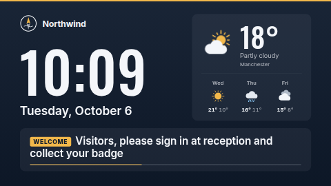

# Info strip

A compact information bar for the edge of a screen: your logo, the time and date, the current
weather and a rotating line of short announcements. It is made for the zones around main content —
the bottom of an L-bar, a strip along the top or bottom, a side column — and rearranges itself for
the shape it is given.

**Kind:** html (code, reviewed). **Network:** none. The weather is read from `ST.data.weather`,
which your server fills from your own Weather data source; the template never talks to a weather
service.



## Layouts

With **Layout** on *Automatic* (the default) the zone's shape picks one of three:

| Zone shape | Layout | What it shows |
| --- | --- | --- |
| wider than 2.4 : 1 (1920×200, 1920×120, 1280×200…) | **strip** | logo · message · weather icon, temperature and condition · clock and date, in one row |
| taller than 3 : 4 (400×1080, 1080×1920…) | **side bar** | logo, a large clock, weekday and date, the weather with the next three days, then the messages |
| anything in between (1920×1080, 1280×720, square) | **full screen** | logo and a very large clock on the left, a weather card with the next three days on the right, the messages in a band along the bottom |

Everything is sized from the zone itself, so a 120 px strip and a 4K wall read the same. When a strip
is too narrow to leave room for the message, the organisation name beside the logo is dropped
first, then the weather condition text, then the logo. A side bar that is too short for the
forecast and the messages drops the forecast. You can force a layout with the **Layout** setting.

## Messages

One message per line in **Messages**; they take turns every **Seconds per message**. Start a line
with a short label and a `|` to show the label as a coloured tag:

```
Today | All-hands in the Atrium at 15:30
Fire alarm test on Thursday at 11:00
```

Each message is shown as large as the space allows; a long one wraps, then shrinks to a readable
minimum, and anything that still does not fit is cut off with an ellipsis — keep them short, about
one sentence. Up to 50 lines are used. With one message it simply stays; with none the bar shows
only the clock, date, weather and logo.

## Weather (optional)

Create a data source of type **Weather** (Data Sources → New → Weather) and pick it in **Weather
data source**. The template uses its `temperature`, `condition`, `code` (for the icon), `location`
and, for the next three days, `day1…day3_high`, `_low`, `_code` and `_date`. Units (°C or °F) are set on
the data source. The condition words and the weekday names under the forecast follow the
template's **Language**.

With no data source chosen, or before its first sync, the weather is simply left out and the other
parts take its room — nothing shows as blank or "undefined". The icon switches to a moon between
20:00 and 06:00 in the template's timezone.

## Settings

| Setting | Type | Default | Notes |
| --- | --- | --- | --- |
| Messages | textarea (2000) | six sample office announcements | one per line, optional `Label \|` tag |
| Seconds per message | number 3–120 | 8 | |
| Weather data source | data source | none | optional; see above |
| Location name | text (40) | empty | shown under the temperature (side bar, full screen); empty = the data source's place name |
| Show the next three days | checkbox | on | side bar and full screen only |
| Organisation name | text (40) | Northwind | beside the logo; empty = logo alone |
| Logo | image | bundled placeholder `logo.svg` | a transparent square or wide logo; clear it to hide |
| Clock format | 24-hour / 12-hour / the language's usual | 24-hour | |
| Show seconds | checkbox | off | |
| Date | long / short / numeric / hidden | long | written in the chosen language, e.g. "Tuesday, October 6", "Di., 6. Okt.", "06/10/2026" |
| Timezone | timezone | the screen's own | for the clock, the date and day/night on the weather icon |
| Language | locale | the screen's own | weather words, date, weekday and number format |
| Layout | Automatic / strip / side bar / full screen | Automatic | |
| Background colour | colour | `#0F1B2D` | a light background switches the weather icons to darker shades automatically |
| Accent colour | colour | `#F2B84B` | tags, the accent line, the progress bar, the sun |
| Text colour | colour | `#F4F6FA` | secondary text and dividers are derived from it |
| Accent line | Automatic / top / bottom / left / right / none | Automatic | Automatic is the top edge of a strip and full screen, the left edge of a side bar |
| Animate | checkbox | on | messages slide in, a thin bar shows when the next is due, the sun turns slowly. Turn off for very low-powered players |

## Languages

Set **Language** (or leave it empty for the player's own language):

- The time, date, weekday names and numbers come from the player's `Intl`, so they work in any
  language; in Japanese and Chinese the 12-hour marker goes before the time (午後 2:30).
- The weather condition ("Partly cloudy") is translated from the weather code for German,
  Spanish, French, Hindi, Italian, Japanese, Dutch, Portuguese and Chinese (Simplified); other
  languages show the data source's English text.
- Your messages are shown exactly as typed, in any script; long German words hyphenate, and
  Japanese, Chinese and Hindi wrap normally.
- The dashboard shows the settings and the sample messages in those ten languages
  (`locales/*.json`). Servers that do not know those files simply ignore them.
- The bundled fonts are Latin only; Japanese, Chinese and Hindi use the player's Noto fonts (or its
  own system fonts).

## Files

`index.html`, `style.css`, `app.js`; `locales/` (dashboard translations); `logo.svg` (placeholder); `fonts/inter*.woff2` and
`fonts/oswald*.woff2` (SIL OFL 1.1, see `NOTICE`). Weather icons are drawn in code — no image files
and no emoji font needed.

Licence: MIT (see `LICENSE`); bundled fonts OFL-1.1.
