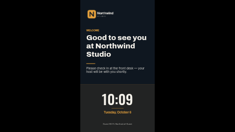

# Lobby welcome (portrait)

A calm welcome screen for a reception, lobby or meeting-room door, laid out for a screen turned on
its side (9:16): your logo at the top, a large headline and a line of detail in the middle, and a
big live clock and date on a tinted panel across the bottom, in the building's own timezone and
language.

The landscape version is [`lobby-welcome`](../lobby-welcome/). Both have exactly the same settings,
so you can copy values from one to the other and run the same welcome on every screen.

**Kind:** slide (declarative, no code runs). Works on every ScreenTinker player that shows slides,
offline, with no internet access.

## Settings

| Setting | Type | Default | What it does |
| --- | --- | --- | --- |
| Logo | image | the bundled placeholder `logo.png` | Top left. Replace it with an image from your content library; a transparent PNG or SVG works best. |
| Small heading | text (40) | `WELCOME` | The accent-coloured label above the headline. Capitals read best. |
| Headline | text (60) | `Good to see you at Northwind Studio` | The big message. About 35 characters take three lines; the full 60 take four and reach the accent rule. |
| Detail line | text (120) | a check-in instruction | Under the rule, in lighter type. Two lines at the default length, three at most. |
| Footer | text (80) | `Guest Wi-Fi: Northwind-Guest` | Small centred line at the bottom of the clock panel. |
| Accent colour | colour | `#E8A33D` | Small heading, rules, the date and the panel tint. |
| Background colour | colour | `#0F1720` | The page. |
| Text colour | colour | `#F4F1EA` | Headline, detail line, clock and footer. |
| Clock timezone | timezone | empty = the screen's clock | Which timezone the clock and date show. |
| Language | locale | empty = the screen's language | The date is formatted by the screen in this language (`en-GB`, `de-DE`, `fr-CA` …), so weekday and month names are never hard-coded. |
| Clock format | 24-hour / 12-hour | 24-hour | |

## Tips

- Every element has a fixed place on the slide, so a long headline does not push the detail line
  down: it overlaps it. Stay inside the character limits and preview long text before publishing.
- The logo box is about 2.2 times as wide as it is tall (the placeholder is 660 x 300). A logo of that
  shape fills it exactly; a square one sits centred in it.
- On a landscape screen or a thin strip zone the slide is letterboxed to keep its shape. Use
  `lobby-welcome` for landscape screens.

## Languages

The dashboard shows this template's name, description and every setting's label and help in English, German,
Spanish, French, Hindi, Italian, Japanese, Dutch, Portuguese and Chinese (`locales/<lang>.json`; a
server without translation support simply shows English). The sample texts are translated too: in another dashboard
language the small heading, headline, detail line and footer start out in that language, written to
fit the same layout (the headline stays on two lines in landscape). The date is formatted by the
screen in the **Language** setting (empty = the screen's own language), so weekday and month names
are never hard-coded; the clock is digits only. The slide renderer's bundled fonts cover Latin; Japanese, Chinese and Hindi fall back to the screen's own
fonts (Noto on ScreenTinker players).

## Files

- `template.json`: the slide (`template` = layout, `fields` = the words), with `{{param:…}}` placeholders
- `logo.png`: placeholder logo for the fictional "Northwind Studio", original work, MIT (see `NOTICE`)
- `thumbnail.png`: catalog preview

Licence: MIT (see `LICENSE`).
