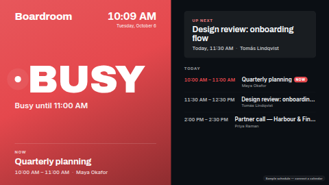

# Meeting room sign

A door sign for a meeting room. A huge **green AVAILABLE** or **red BUSY** band you can read from
down the corridor, with the room name, a clock, "Busy until 11:00" / "Free until 14:30", the meeting
in progress, the next meeting, and today's agenda (up to five bookings). Designed first for a
**portrait panel beside the door** (1080×1920); it also lays itself out for landscape screens and,
in a thin strip zone (wider than about 3:1), as a single line.

**Kind:** html (code, reviewed). **Network:** none — the page fetches nothing. The calendar is read
by the ScreenTinker server and handed to the page when it renders.

## Settings

| Setting | Type | Default | What it does |
| --- | --- | --- | --- |
| Room calendar | data source (optional) | none | A **Calendar (iCal)** source. See below. Without one a sample schedule is shown, marked "Sample schedule". |
| Room name | text (48) | `Boardroom` | Top left of the band. |
| Available text / Busy text | text (24) | empty | The big word. Empty uses the built-in word in the sign's language (`Available` / `Busy`, `Frei` / `Belegt`…), also when a calendar is bound. |
| Privacy: hide meeting titles and organisers | checkbox | off | Every title becomes the "Reserved" text and organisers are hidden. Times stay visible. |
| Text shown instead of a hidden title | text (32) | empty | Also used for a booking that has no title. Empty uses the built-in word (`Reserved`, `Reserviert`…). |
| Show organisers | checkbox | on | Organiser next to the time, where the calendar provides one. |
| Headings | text (24 each) | empty | Empty uses the built-in words in the sign's language (`Now`, `Up next`, `Today`, `Coming up` in English). Type your own to override them. "Coming up" is used instead of "Today" when nothing is left today, and the list then shows the next bookings with their dates. |
| Text when nothing is booked | text (48) | empty | Empty uses the built-in text (`Nothing else booked`…). |
| Available / Busy colour | colour | `#1FA971` / `#E5484D` | The band colour. White text is always used on the band, so pick colours dark enough for it. |
| Background / Text colour | colour | `#0B0F14` / `#F5F7FA` | The agenda half. |
| Clock | choice | Language default | 24-hour, 12-hour, or hide the clock. |
| Clock timezone | timezone | the screen's | Use the room's timezone if the player is set differently. |
| Language | locale | the screen's | The sign's built-in words, the date and the clock (see *Languages*). |

## Data source setup

1. **Data sources → Add → Calendar (iCal)**. Paste the room's iCal address:
   - *Google Workspace:* the room resource calendar → Settings → "Secret address in iCal format".
   - *Microsoft 365 / Exchange:* publish the room mailbox calendar (Outlook on the web → Settings →
     Calendar → Shared calendars → Publish a calendar, "Can view titles and locations" or "Can view
     when I'm busy") and copy the ICS link. With "busy only" publishing, titles arrive as "Busy" —
     turn on Privacy mode for a cleaner sign.
   - Any other `.ics` URL works.
2. Set the data source's **timezone** to the room's (the same zone as the sign's clock) and its
   refresh interval (5 minutes is typical). Its language should match the sign's *Language*, though
   the sign re-words the server's text either way (see *Languages*).
3. Bind it to **Room calendar** in this template's settings.

Keys used (from the server's iCal resolver): `is_busy` decides green or red — never the translated
text — then `status_detail`, `current_title`, `current_time`, `current_organizer`,
`next_title`, `next_time`, `next_organizer`, `event_count`, `events_today_count` and
`event_N_title`, `event_N_time`, `event_N_date`, `event_N_organizer`. The booking in progress is
highlighted in the agenda. If the bound source is not a calendar (it has no `is_busy`), the sample
schedule is shown rather than a broken sign.

The page re-reads its data every 60 seconds; the band flips as soon as the server's next sync sees a
meeting start or end, so set the data source's refresh to match how quickly you need that.

## Languages

- **On the sign.** The *Language* setting (empty = the player's own language) picks the built-in
  words — Available / Busy, Reserved, Now, Up next, Today, Coming up, Nothing else booked, the
  sample schedule — in English, German, Spanish, French, Hindi, Italian, Japanese, Dutch,
  Portuguese and Simplified Chinese (by the first part of the tag, so `de-CH` gets German; any
  other language falls back to English words). The date and clock are formatted by the browser's
  own `Intl` data in that language. Any text you type into a setting wins over the built-in word.
  With a calendar bound, the server writes its text ("Busy until 11:00 AM", "Today, 2:00 PM",
  "All day", "Busy" for a private title) in the data source's own language, English unless set.
  The sign recognises that text in any of the ten languages and says it again in its own language
  and clock format, so a German sign shows "Belegt bis 11:00" even with an English calendar.
  Meeting titles are shown as written. Give the calendar the same timezone as the clock.
- **In the dashboard.** `locales/<lang>.json` translates the template's name, description and
  setting labels for de, es, fr, hi, it, ja, nl, pt and zh, and gives a translated sample room
  name. Servers that do not know these files ignore them; the template works the same.
- The page sets its `lang` attribute from the language, so long German words hyphenate and
  Chinese/Japanese break lines correctly. The bundled fonts are Latin-only; Chinese, Japanese and
  Devanagari text uses the player's Noto fonts (`Noto Sans CJK`, `Noto Sans Devanagari`).

## Files

`index.html`, `style.css`, `app.js` — inlined by the server at render time. `fonts/` holds the
Archivo and Inter latin subsets (SIL OFL 1.1, see `NOTICE`).

## Changes

- **1.1.0** — every word on the sign follows the *Language* setting (built-in words for ten
  languages, see *Languages*); the heading and status settings now default to empty (= the built-in
  word); the *Clock language* setting is now *Language*; dashboard translations in `locales/`;
  font fallbacks for Chinese, Japanese and Devanagari; the agenda's time column is measured in the
  right font, so the titles line up. With a calendar bound, the big word, the status line, times and
  day names are now in the sign's language whatever the data source's language is, and *Available
  text* / *Busy text* now apply with a calendar too. **Upgrading:** a sign that kept the old English
  defaults (`Available`, `Busy`, `Reserved`, `Now`, `Up next`, `Today`, `Coming up`, `Nothing else
  booked`) as saved values stays English — clear those text fields to get the built-in words.
- **1.0.1** — the sample schedule's "Up next" line said "Today, …" in English whatever the
  *Language* setting; the word now comes from the screen's language (`Intl.RelativeTimeFormat`).
- **1.0.0** — first release.

Licence: MIT (see `LICENSE`); bundled fonts OFL-1.1.
