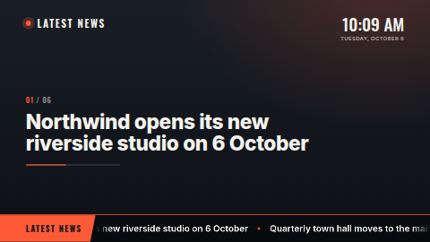

# News ticker

Headlines shown two ways at once: a large **featured headline** that rotates every few seconds with
a progress bar, and a smooth **scrolling ticker**. Type the headlines in, or connect an RSS feed, a
Google Sheet, a CSV or a table and they follow it.

The layout follows the shape of the zone:

| Zone shape | What you get |
| --- | --- |
| Landscape (e.g. 1920×1080) | header with clock, featured headline, ticker bar along the bottom |
| Portrait (e.g. 1080×1920) | header, featured headline in the top half, the ticker scrolling **upwards** below it |
| Tall and narrow (narrower than about 2:5, e.g. a 480×1920 side zone) | a vertical side ticker: title, clock and the upward-scrolling headlines |
| Thin strip (wider than about 3:1, e.g. 1920×200) | just the ticker bar |

**Kind:** html (code, reviewed). **Network:** none. The screen fetches nothing; a bound data source
is fetched by your ScreenTinker server and handed to the page.

## Settings

| Setting | Type | Default | What it does |
| --- | --- | --- | --- |
| Title | text (32) | `Latest news` | Shown in the header and on the ticker's label |
| Headlines data source | data source, optional | none | An RSS/Atom feed, Google Sheet, CSV or Manual table. When it has headlines, they replace the typed list |
| Headline column | text (80) | `Headline` | For a Sheet, CSV or table: the header of the column with the headlines. If no column has this name, the first column is used. Ignored for RSS |
| Headlines | textarea, one per line | six example headlines | Used when no data source is connected, and while a connected one is empty or has not synced yet |
| Show at most | number 1–30 | 12 | Headlines beyond this number are not shown |
| Ticker speed | number 20–400 | 120 | Pixels per second on a 1080-pixel-high landscape screen, scaled with the screen. Vertical tickers run at a calmer 40% of this, scaled by the zone's width |
| Seconds per featured headline | number 4–60 | 8 | How long each featured headline stays |
| Accent / Background / Text colour | colour | `#FF5A36` / `#11161D` / `#F5F3EE` | |
| Show the clock | checkbox | on | Time and date in the header |
| Clock timezone | timezone | the screen's own | |
| Language | locale | the screen's own | Language of the date and of the built-in words (see *Languages*) |

## Connecting a data source

Create the data source on your server (*Data sources → New*), then pick it in **Headlines data
source**. The page shows a snapshot of the source; the server re-renders it whenever the source
syncs, so new headlines appear on their own.

- **RSS / Atom feed:** each item's title (`item1_title`, `item2_title`, …) becomes a headline, in
  feed order. Nothing else is needed. Item images are not used (no network access).
- **Google Sheet, CSV or Manual table:** one headline per row, from the column whose header matches
  **Headline column** (case and punctuation do not matter: `Headline`, `headline`, `HEADLINE` all
  match). Any other columns are ignored. For example:

  | Headline | Date |
  | --- | --- |
  | Northwind opens its new riverside studio on 6 October | 2026-10-01 |
  | Quarterly town hall moves to the main atrium | 2026-10-03 |

  Blank cells are skipped. Rows appear in sheet order.

**Row limit.** A data source reaches an html template as at most **300 values** (and 2000
characters per value). A feed uses 7 values per item, so roughly the first 40 items arrive; a
table uses one value per cell, so a 2-column sheet delivers about 145 rows but a 10-column one only
about 29. The template shows at most 30 headlines anyway (**Show at most**). Keep a headline sheet
narrow, or put the headline column first.

## Languages

The settings form (name, description, every label and help text, and the example title, column name
and headlines) is translated into German, Spanish, French, Hindi, Italian, Japanese, Dutch, Portuguese and Simplified Chinese in `locales/<lang>.json`; English
in `manifest.json` stays the source and fallback. A server that does not know about `locales/`
simply ignores the folder.

On screen, the **Language** setting (empty = the player's own language) sets the date and time
format (`Intl`), the page's `lang` (for hyphenation and line breaking) and the few built-in words:
the fallback title and the "add headlines" hint, from a table in `app.js` in the same ten
languages (other languages fall back to English). Headlines are shown exactly as typed or fed.
The bundled Inter and Oswald subsets are Latin-only; Japanese, Chinese and Hindi text uses the
player's Noto Sans CJK / Noto Sans Devanagari (or system) fonts.

## Files

`index.html`, `style.css`, `app.js` — all inlined by the server at render time. `fonts/` holds the
Inter and Oswald latin subsets (SIL OFL 1.1, see `NOTICE`).

## Changes

- **1.1.0** — translations of the settings into nine languages (`locales/`), built-in words and
  number formatting follow the Language setting; optional data source (RSS/Atom, Google Sheet, CSV, table) with the typed list as
  fallback; portrait layout with a vertical ticker, and a side-ticker layout for tall narrow zones;
  long headlines shrink to fit the featured area.
- **1.0.0** — first release.

Licence: MIT (see `LICENSE`); bundled fonts OFL-1.1.
