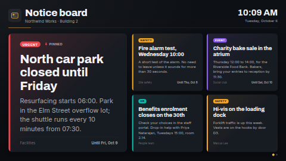

# Notice board

An announcements board for a staff room, a school corridor, a shop floor or an office lobby. Each
notice is a card with a title, a few lines of text, a colour-coded category pill (Urgent, Safety,
Event, HR, IT, Info and more) and, if you like, who posted it. Notices can carry a **start** and an
**end**: a notice stays hidden until it starts and disappears after it ends, all on the screen's
own clock, so you can line up next week's notices today. **Pinned** notices are held at the top.

Two layouts:

- **Featured**: the first notice (pinned ones come first) large, the rest in a grid of equal cards
  beside it (landscape) or under it (portrait). When there are more cards than fit at a readable
  size, the grid pages every few seconds. With only two to four notices live, the others stack in
  one column of large cards that share the full height, so a quiet board still fills the screen.
- **One at a time**: each notice fills the screen in turn.

In a thin strip zone (wider than about 3:1) both become a single line that shows one notice at a time.

Type the notices in, or connect a data source (a Google Sheet is the easy one) so anyone with the
sheet can post a notice from a phone.

**Kind:** html (code, reviewed). **Network:** none. Nothing is fetched; it works fully offline.

## Settings

| Setting | Type | Default | What it does |
| --- | --- | --- | --- |
| Board title | text (48) | `Notice board` | The big heading. |
| Subtitle | text (80) | `Northwind Works · Building 2` | One line under the title. Empty hides it. |
| Logo | image | none | Optional, shown beside the title. Without one a small board icon in the accent colour is shown. |
| Layout | select | Featured | *Featured notice + the others beside it*, or *One notice at a time, full screen*. |
| Notices | textarea (2000) | 8 sample notices | One notice per line: `Title \| Text \| Category \| Start \| End \| Pinned \| From`. Only the title (or the text) is required; leave a field empty to skip it. Used when no data source is connected. |
| Notices data source | data source | none | Optional. A table-shaped source (Google Sheets, CSV, Manual table). When connected, it replaces the typed notices. |
| Title / Text / Category / Start / End / Pinned / From column | text | `Title`, `Text`, `Category`, `Start`, `End`, `Pinned`, `From` | The column headings in your source. Case, spaces and punctuation don't matter (`Posted by` matches `posted_by`). If a heading isn't found, common alternatives are tried (for example `Body` or `Message` for the text, `Expires` or `Until` for the end, `Author` for From). |
| Dates written with slashes are | select | guess | How to read `03/04/2026`: day first, month first, or guess from the language (month first only for US English). `2026-10-14` is always understood, and a date like `25/12/2026` is unambiguous anyway. |
| Category colours | textarea (600) | empty | Optional overrides, one per line: `Canteen = #D98C2B`. |
| Theme | select | Dark | Dark or Light cards and background. |
| Accent colour | colour | `#F2B33D` | The title rule, the page dots, the board icon, and notices without a category. |
| Seconds per page or notice | number 5–120 | 12 | How long each page of the grid, or each notice in *one at a time*, stays up. |
| Show "until" dates on cards | checkbox | on | Puts *Until Fri 9 Oct* (or *Ends today 17:00*) at the foot of notices that have an end. |
| Text before an end date | text (24) | empty | Empty shows "Until …" in the screen's language. Text you type goes in front of the date. |
| Text for a notice ending today | text (24) | empty | Empty shows "Ends today" (or "Ends today at 17:00") in the screen's language. A time is added after text you type when the end has one. |
| Pinned badge text | text (24) | empty | Shown beside the pin icon. Empty shows "Pinned" in the screen's language. |
| Text when there are no notices | text (60) | empty | Shown when nothing is live. Empty shows "No notices right now" in the screen's language. |
| Clock | select | language default | 24-hour, 12-hour, or hide the clock and date. |
| Timezone | timezone | screen's clock | Used for the clock **and** for notice start and end times. |
| Language | locale | screen's language | The board's own words follow it (see *Languages*). Day and month names are formatted by the browser in this language (`fr-FR` gives *mar. 6 oct.*). |

### Categories and colours

The category is shown as typed. Its colour comes from the category name: *Urgent*, *Emergency*,
*Alert* and *Closure* are red (and tint the whole card); *Important* and *Deadline* orange; *Safety*,
*Health & Safety* and *Security* amber; *Event* and *Social* purple; *HR*, *People* and *Staff* teal;
*IT* and *Tech* blue; *Info* and *General* sky blue; *News* green; *Facilities* and *Maintenance*
lime; *Celebration*, *Birthday* and *Welcome* pink; *Reminder* yellow; *Training* green; *Exam*,
*Academic* and *School* cyan; *Sport* orange; plus *Production*, *Quality*, *Shift* and *Canteen*.
Any other category gets a steady colour of its own from the same palette (the same name always gets
the same colour). Use *Category colours* to choose your own. A notice without a category gets the
accent colour and no pill.

### Start and end

| You write | It means |
| --- | --- |
| *(empty)* | No limit. |
| `2026-10-14` | Start: from 00:00 that day. End: until the end of that day (it is still up all of the 14th). |
| `2026-10-14 17:00` | That exact time, in the board's timezone. `2026-10-14T17:00Z` or `+02:00` are exact moments. |
| `14/10/2026`, `10/14/2026 5:00 PM`, `14.10.2026` | Slash or dot dates, read with *Dates written with slashes are*. |
| `+3`, `-1`, `+0 17:30` | Days from today (and optionally a time): handy for the sample notices and for a notice you re-use. |

Google Sheets date cells arrive in the sheet's own display format, so set *Dates written with
slashes are* to match the sheet's locale, or format the column as `yyyy-mm-dd`. A start or end the
board cannot read is ignored (the notice shows). The board re-checks every 30 seconds, so a notice
appears or disappears within half a minute of its time without anything being re-published.

### Pinned and order

A Pinned value of `yes`, `y`, `true`, `1`, `x` or `pinned` (any case) pins a notice. Pinned notices
come first, then the rest in the order of the list or sheet. In the *Featured* layout the first
notice is the featured one, so pin the notice you want featured.

## Using a Google Sheet or Manual table

1. Make a sheet with a header row: `Title`, `Text`, `Category`, `Start`, `End`, `Pinned`, `From`
   (only `Title` is required; leave out the columns you don't need).
2. In ScreenTinker, *Data sources → New → Google Sheets* (or *Manual table*) and point it at the sheet.
3. Choose that source for *Notices data source*. If your headings differ, type them into the
   column settings.

When a table source is connected the typed notices are not used, even if the sheet is empty or
its title column can't be found: the board then shows *Text when there are no notices*, never the
sample notices. (While the source has not synced for the first time, the typed notices show.)

**Row limit.** A data source hands an html template at most 300 values today, and every column of
every row counts. With the seven columns above that is about **40 notices**; with only Title, Text,
Category and End it is about 70 (the board reads at most 60). Put the notices that matter first, and
delete expired rows from time to time. Each cell is cut at 500 characters.

## Languages

The board's own words ("Until …", "Ends today", "Pinned", the empty-board text) come in English,
German, Spanish, French, Hindi, Italian, Japanese, Dutch, Portuguese and Chinese, picked by the
*Language* setting (or the screen's language when it is empty); any other language falls back to
English. Dates and the clock are formatted by the player in that language. Category colours also
know the main categories in those languages (`Dringend`, `Sécurité`, `緊急`, `सुरक्षा`…), and a
Pinned cell of `ja`, `oui`, `sí`, `sim`, `はい`, `是` or `हाँ` pins a notice.

`locales/<lang>.json` translates the settings in the dashboard (names, help, options) and gives a
translated title, subtitle and a shorter sample of notices. Older servers ignore these files; the
template works the same without them. Column headings for a data source should use Latin letters:
the server turns a heading like `タイトル` into `col1`.

The bundled fonts are Latin-only; Japanese, Chinese and Hindi text uses the player's Noto (or
system) fonts.

## Files

`index.html`, `style.css`, `app.js` — all inlined by the server at render time. `fonts/` holds the
Archivo and Inter latin subsets (SIL OFL 1.1, see `NOTICE`). The board and pin icons are inline SVG
drawn for this template.

Licence: MIT (see `LICENSE`); bundled fonts OFL-1.1.
