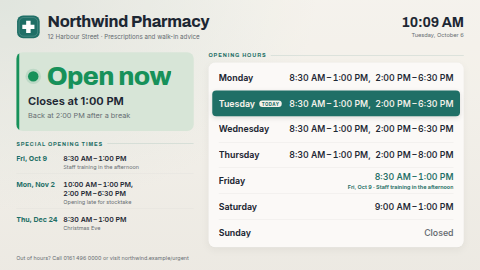

# Opening hours

Your opening hours with a live status anyone can read across the room: a big **Open now** with
"Closes at 13:00" (and "Back at 14:00 after a break" when you close for lunch), an amber
**Closing soon** in the last half hour, or **Closed** with "Opens tomorrow at 08:30". Beside it, the
week's hours with today highlighted, and a short list of upcoming special opening times: holiday
closures, a late start for stocktake, reduced hours on Christmas Eve. A special date overrides the
regular week on the day it applies, in the status, in the week table and in the list.

Made for shops, pharmacies, libraries, clinics, town halls and offices. Day names, dates and times
come from the screen's language (or the one you choose), in the business's own timezone.

**Kind:** html (code, reviewed). **Network:** none — nothing is fetched; it works fully offline.



## Settings

| Setting | Type | Default | What it does |
| --- | --- | --- | --- |
| Name | text (60) | `Northwind Pharmacy` | The big heading. |
| Subtitle | text (100) | an address line | One line under the name. Empty hides it. |
| Footer line | text (140) | an out-of-hours note | Small print along the bottom. Empty hides it. |
| Logo | image | a placeholder mark | Shown beside the name. Replace it with yours, or clear it. |
| Monday … Sunday | text (120) | a pharmacy week with a lunch break | The regular hours for each day; see *Writing hours* below. |
| Week starts on | select | Monday | Monday, Sunday or Saturday: the first row of the week table. |
| Special dates | textarea | Christmas, New Year and two sample one-offs | One per line: `Date \| Hours \| Note`; see *Special dates*. Used when no data source is connected. |
| Special dates data source | data source | none | Optional. A table (Google Sheet, CSV, Manual table) with Date, Hours and Note columns. When connected, it replaces the typed special dates. |
| Date / Hours / Note column | text | `Date`, `Hours`, `Note` | The column headings in your source. Case, spaces and punctuation don't matter. |
| Upcoming special dates to list | number 0–6 | 3 | How many upcoming special dates to list. 0 hides the list (the week table still shows a special day's hours). |
| Status: open | text | empty | The big word while open. Empty: *Open now* in the screen's language. |
| Status: closing soon | text | empty | The big word in the last minutes before closing. Empty: *Closing soon*. |
| Status and table: closed | text | empty | The big word while closed, and the text for a closed day in the table. Empty: *Closed*. |
| Open around the clock | text | empty | Shown for a `24h` day, and as the status when it never closes this week. Empty: *Open 24 hours*. |
| Closing line | text | empty | Under the status while open. `{time}` is the closing time. Empty: *Closes at {time}*; `-` hides it. |
| Break line | text | empty | Second line while open, when it opens again later the same day. Empty: *Back at {time} after a break*; `-` hides it. |
| Opening line | text | empty | Under the status while closed. `{day}` is the language's own *today* / *tomorrow*, or a weekday name; `{time}` the opening time. Empty: *Opens today / tomorrow / on Monday at …*; `-` hides it. |
| Heading: this week | text | empty | Above the week table. Empty: *Opening hours*; `-` hides the heading. |
| Heading: special dates | text | empty | Above the special dates list. Empty: *Special opening times*; `-` hides the heading. |
| Today marker | text | empty | The pill on today's row. Empty uses the language's own word for *today* (`Heute`, `Aujourd’hui` …). |
| Timezone of the business | timezone | empty | Where the opening hours are. Empty uses the screen's clock. Set it whenever the screen might be set to another zone. |
| Language | locale | empty | For example `en-GB`, `fr-FR`, `de-DE`. Empty uses the screen's language. The built-in words, weekday and month names, the date format and 12/24-hour time follow it. |
| Times and clock | select | language default, clock shown | Force 24-hour or 12-hour times, or hide the clock in the corner. |
| Heading font | select | Archivo | Archivo (display), Bitter (serif) or Inter (clean). Body text is always Inter. |
| Background / Text / Accent colour | colour | `#F4F1EA` / `#1D2733` / `#1F6F66` | Accent colours today's row, the headings and special dates. Dark backgrounds work too. |
| Open / Closing soon / Closed colour | colour | `#17915A` / `#C9820A` / `#C8423B` | The status card in each state. |
| Closing soon, minutes before closing | number 0–120 | 30 | When the amber state starts. 0 turns it off. |

## Languages

Everything on screen follows **Language** (empty = the player's own language):

- The status words, the lines under them, the two headings and the *today* pill are built in for
  English, German, Spanish, French, Hindi, Italian, Japanese, Dutch, Portuguese and Chinese
  (Simplified), picked by the language's first part (`de-CH` uses German). Other languages get
  English words with their own day names, dates and times. Type a label to override a word; a
  typed label always wins.
- Weekday and month names, dates, 12/24-hour times and *today* / *tomorrow* come from the
  player's `Intl`, so they work in any language.
- A closed day can be written `Closed` or in any of those languages (`Geschlossen`, `Fermé`,
  `Cerrado`, `休業`, `休息`, `बंद` …); `~` and `〜` work between two times as well as `-`.
- The dashboard shows the settings, the sample week and the sample special dates in the same ten
  languages (`locales/*.json`). Servers that do not know those files simply ignore them.
- The bundled fonts are Latin only; Japanese, Chinese and Hindi use the player's Noto fonts (or its
  own system fonts). Column headings for a data source must be in Latin letters, because the
  server keys columns by their Latin name.

## Writing hours

| You type | It means |
| --- | --- |
| `09:00-17:00` | one opening |
| `08:30-13:00, 14:00-18:30` | split hours (a lunch break); up to six ranges, separated by commas |
| `9am-5pm`, `9:30 am – 1 pm`, `9h-12h30` | 12-hour times and other common spellings work too |
| `18:00-02:00` | runs past midnight: still *open* at 01:00 the next morning |
| `24h` or `00:00-24:00` | open all day |
| `Closed`, or leave it empty | closed all day |
| anything else, like `By appointment` | shown exactly as typed, counted as closed for the status |

The table always shows times in the screen's language and clock style, so `14:00` may appear as
`2:00 PM`.

## Special dates

One date per line, `Date | Hours | Note`; lines starting with `#` are ignored.

```
12-24 | 08:30-13:00 | Christmas Eve
12-25..12-26 | Closed | Christmas
2026-11-02 | 10:00-13:00, 14:00-18:30 | Opening late for stocktake
2027-01-04..2027-01-08 | 10:00-16:00 | Winter hours
```

- `2026-12-24` is one date (`2026/12/24` also works). `12-24` (month-day) repeats every year.
- A range is two dates joined with `..` (or a spaced dash: `2026-12-24 - 2026-12-26`). A yearly
  range may cross New Year (`12-31..01-01`).
- Hours are written exactly as in the week (`Closed`, split hours, `24h` …).
- A dated line beats a yearly one; otherwise the first line that matches wins.
- Past dates simply stop showing; you don't have to delete them.

The week table always shows the **next** occurrence of each weekday (today included), so when a
special date falls in the coming seven days its row shows the special hours, the date and the note.
The list underneath shows the next few special dates, up to about a year ahead.

## Using a Google Sheet for special dates

1. Make a sheet with a header row `Date`, `Hours`, `Note`, one special date per row, written as
   above. Format the Date column as **plain text** (Format → Number → Plain text) so Sheets does not
   turn `12-24` into a date in your own format; `2026-12-24` style dates are safest.
2. In ScreenTinker, *Data sources → New → Google Sheets* and point it at the sheet.
3. Choose that source for *Special dates data source*. If your headings differ, type them into the
   column settings.

A data source hands a template at most 300 values today, so the first ~95 rows of a three-column
sheet reach the screen — more than enough for years of holidays. When the source has not synced yet
or has no Date column, the typed special dates are used instead.

## Files

`index.html`, `style.css`, `app.js` — all inlined by the server at render time. `locales/` holds the
dashboard translations. `logo.svg` is an
original placeholder. `fonts/` holds the Archivo, Bitter and Inter latin subsets (SIL OFL 1.1, see
`NOTICE`).

Licence: MIT (see `LICENSE`); bundled fonts OFL-1.1.
