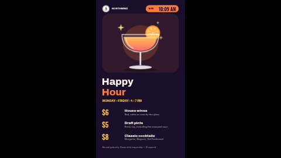

# Happy hour promo (portrait)

A happy hour (or any daypart offer: brunch, lunch deal, late bites) for a bar or restaurant: a big headline, the days and hours, three deals with prices and a note each, a drink picture with a warm glow, and a live clock in the corner so guests can see how long is left.

**Kind:** slide (declarative — no code runs). Works on every ScreenTinker player that shows slides.
**Shape:** portrait 9:16, for a screen mounted on its side (1080×1920). The same design in landscape is
[`promo-happy-hour`](../promo-happy-hour/). On a zone of another shape the player letterboxes the slide rather than
stretching it, so in a thin strip it shows small and centred: use an info strip or ticker template there.
**Network:** none. **Data source:** none — everything is typed into the settings.

Part of the promo pack: `promo-price-drop`, `promo-bogo`, `promo-new-arrival` and `promo-happy-hour`, each in
landscape and portrait, sharing the same logo and store-name settings so a playlist of them looks like one campaign.

## Settings

| Setting | Type | Default | What it does |
| --- | --- | --- | --- |
| Logo | image | bundled `logo.svg` | Top left. The bundled badge is a placeholder for the fictional "Northwind" stores: replace it with your own (a square-ish PNG or SVG). |
| Show the logo | checkbox | on | Off hides the logo (an empty logo setting with this on shows a faint dashed box). |
| Store name | text (22) | `NORTHWIND` | Shown beside the logo. Leave empty if your logo already includes the name. |
| Headline, first line | text (10) | `Happy` | The headline is set in two big lines, a word or two each: Happy / Hour, Weekend / Brunch, Late / Bites. |
| Headline, second line (accent) | text (10) | `Hour` |  |
| When it runs | text (36) | `MONDAY – FRIDAY · 4 – 7 PM` | Typed as it should read; unlike the clock it is not translated. Schedule the slide in your playlist to show only during these hours. |
| Deal 1 price | text (7) | `$6` |  |
| Deal 1 name | text (20) | `House wines` |  |
| Deal 1 note | text (40) | `Red, white or rosé by the glass` |  |
| Deal 2 price | text (7) | `$5` |  |
| Deal 2 name | text (20) | `Draft pints` |  |
| Deal 2 note | text (40) | `Every tap, including the seasonal sour` |  |
| Deal 3 price | text (7) | `$8` |  |
| Deal 3 name | text (20) | `Classic cocktails` |  |
| Deal 3 note | text (40) | `Margarita, Negroni, Old Fashioned` |  |
| Product picture | image | bundled `cocktail.svg` | A cut-out PNG or SVG with a transparent background looks best; a photo works too. It is fitted inside its box, never cropped. |
| Show the product picture | checkbox | on | Off hides the picture. (An empty picture setting with this on shows a faint dashed box, which is how the slide renderer marks a missing image.) |
| Show the clock | checkbox | on | A live clock in the top corner, so guests can see how long is left. |
| Clock label | text (6) | `NOW` |  |
| Clock timezone | timezone | empty | Leave empty to use the screen’s own clock. |
| Language | locale | empty | The language of the clock, e.g. en-US or de-DE. Leave empty for the screen’s language. |
| Clock format | 24-hour / 12-hour | 24-hour | 24-hour suits most countries. Pick 12-hour (AM/PM) for the US and other places that use it. |
| Small print | text (120) | a sample line |  |
| Accent colour | color | `#FF7A3D` | The second headline line, the glow behind the picture and the clock pill. |
| Price colour | color | `#FFC24B` | The deal prices and the hours line. |
| Background colour | color | `#190F2B` |  |
| Text colour | color | `#FFF4E8` | Headlines and body text. |
| Background photo | image | none | Optional photo behind everything. |
| Darken the photo | number 0–0.9 | `0.65` | A black scrim over the photo so the text stays readable. Ignored without a photo. |

All text is shown exactly as you type it, so prices, currency signs and dates are written the way
your customers read them (`$179`, `179 €`, `£179.99`, `Avant 249,00 €`) — nothing is translated or
reformatted.

### The clock and dayparting

The clock shows the time on the screen (or in **Clock timezone**), with the numbers and AM/PM words of
**Language** (empty = the screen's own language). **Clock format** defaults to 24-hour, which suits
most countries; in the US and other places that use AM/PM, pick 12-hour. The slide does not switch itself on and off: put it in a playlist with a schedule
(for example weekdays 16:00–19:00) so it only plays during the offer, and the clock tells guests how
long they have. The three deals are fixed rows — clear a row's price, name and note to leave it empty.

## Languages

The settings page is translated into `de`, `es`, `fr`, `hi`, `it`, `ja`, `nl`, `pt`, `zh` (`locales/<lang>.json`; English
in `manifest.json` is the source and the fallback). A server that reads these files shows the setting
names, help and options in the operator's language, and **pre-fills the text settings with translated
sample text** — prices in the local currency and idiomatic short signage lines, each checked against the
setting's maximum length and rendered in German, Japanese and Hindi to make sure it fits. Older servers
ignore the folder and show English; the slide works the same either way.

Every word on the slide is a setting, so the slide shows whatever language you type. The live clock
follows **Language** (empty = the screen's language). The bundled slide fonts are Latin-only; Japanese,
Chinese and Hindi text is drawn in the player's system fallback font (for example Noto Sans CJK or Noto
Sans Devanagari), so it renders, in a different typeface. A player with no CJK or Devanagari font at all
shows boxes for those characters. Brand and sample product names (Northwind, Harbour,
Studio Pro) are kept in every language.

## Tips

- Every text setting has a maximum length, and the layout is drawn so that text at that maximum still
  fits without running into the next line (checked with long, wide words in both orientations).
  Slide text boxes do not shrink to fit, so the maximum is the guard: if a word will not fit, shorten it
  rather than looking for a way around it. Short big lines read best from across a room anyway.
- Colours: the defaults are tuned for contrast. If you change the background, check the accent and
  text colours still read from across the room.
- A background photo goes behind the whole slide; raise **Darken the photo** until the
  text is comfortable to read.

## Files

- `locales/` — translations of the settings page (see Languages)
- `template.json` — the slide (`template` = layout, `fields` = the words), with `{{param:…}}` placeholders
- `logo.svg` — placeholder badge, original work, MIT (see `NOTICE`)
- `cocktail.svg` — sample product picture, original work, MIT (see `NOTICE`)
- `thumbnail.png` — catalog preview

Licence: MIT (see `LICENSE`).
