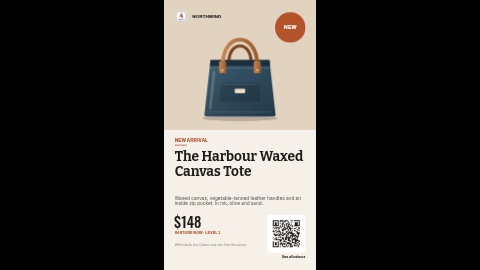

# New arrival promo (portrait)

A calm, editorial screen for a new product: a serif product name, a short description, the price and where to find it in the store, the product on a tinted panel with a round "New" sticker, and an optional QR code that opens the product page on a phone.

**Kind:** slide (declarative — no code runs). Works on every ScreenTinker player that shows slides.
**Shape:** portrait 9:16, for a screen mounted on its side (1080×1920). The same design in landscape is
[`promo-new-arrival`](../promo-new-arrival/). On a zone of another shape the player letterboxes the slide rather than
stretching it, so in a thin strip it shows small and centred: use an info strip or ticker template there.
**Network:** none. **Data source:** none — everything is typed into the settings.

Part of the promo pack: `promo-price-drop`, `promo-bogo`, `promo-new-arrival` and `promo-happy-hour`, each in
landscape and portrait, sharing the same logo and store-name settings so a playlist of them looks like one campaign.

## Settings

| Setting | Type | Default | What it does |
| --- | --- | --- | --- |
| Logo | image | bundled `logo.svg` | Top left. The bundled badge is a placeholder for the fictional "Northwind" stores: replace it with your own (a square-ish PNG or SVG). |
| Show the logo | checkbox | on | Off hides the logo (an empty logo setting with this on shows a faint dashed box). |
| Store name | text (22) | `NORTHWIND` | Shown beside the logo. Leave empty if your logo already includes the name. |
| Small heading | text (30) | `NEW ARRIVAL` |  |
| Round sticker | text (6) | `NEW` | One short word. Leave empty for a plain dot. |
| Product name | text (34) | `The Harbour Waxed Canvas Tote` | Room for three lines; 34 characters is the most that always fits. |
| Description | text (120) | a sample line |  |
| Price | text (10) | `$148` | As it should read, e.g. $148 or 1.299,00 €. Leave empty to hide. |
| Where to find it | text (40) | `IN STORE NOW · LEVEL 1` |  |
| Product picture | image | bundled `tote.svg` | A cut-out PNG or SVG with a transparent background looks best; a photo works too. It is fitted inside its box, never cropped. |
| Show the product picture | checkbox | on | Off hides the picture. (An empty picture setting with this on shows a faint dashed box, which is how the slide renderer marks a missing image.) |
| Show the QR code | checkbox | on | Turn off if you have no link: the code, its card and caption disappear. |
| QR link | text (300) | `https://example.com/harbour-tote` | The page the code opens. Shorter links scan from further away. |
| QR caption | text (22) | `See all colours` |  |
| Small print | text (120) | a sample line |  |
| Accent colour | color | `#B4532A` | The small heading, sticker and rules. |
| Picture panel colour | color | `#E2D3C1` |  |
| Background colour | color | `#F5F0E8` |  |
| Text colour | color | `#1F1B17` | Headlines and body text. |
| Sticker text colour | color | `#FFFFFF` |  |
| Background photo | image | none | Optional photo behind everything. |
| Darken the photo | number 0–0.9 | `0.3` | A black scrim over the photo so the text stays readable. Ignored without a photo. |

All text is shown exactly as you type it, so prices, currency signs and dates are written the way
your customers read them (`$179`, `179 €`, `£179.99`, `Avant 249,00 €`) — nothing is translated or
reformatted.

### The QR code

The code is drawn by the server on a white card, so it scans even on a dark or photo background.
Point a phone at the screen from where customers will stand before you rely on it; shorter links make
a coarser code that scans from further away. Turn **Show the QR code** off if you have no link.

## Languages

The settings page is translated into `de`, `es`, `fr`, `hi`, `it`, `ja`, `nl`, `pt`, `zh` (`locales/<lang>.json`; English
in `manifest.json` is the source and the fallback). A server that reads these files shows the setting
names, help and options in the operator's language, and **pre-fills the text settings with translated
sample text** — prices in the local currency and idiomatic short signage lines, each checked against the
setting's maximum length and rendered in German, Japanese and Hindi to make sure it fits. Older servers
ignore the folder and show English; the slide works the same either way.

Every word on the slide is a setting, so the slide shows whatever language you type. The bundled slide fonts are Latin-only; Japanese,
Chinese and Hindi text is drawn in the player's system fallback font (for example Noto Sans CJK or Noto
Sans Devanagari), so it renders, in a different typeface. A player with no CJK or Devanagari font at all
shows boxes for those characters. Brand and sample product names (Northwind, Harbour,
Studio Pro) are kept in every language.

## Tips

- Every text setting has a maximum length, and the layout is drawn so that text at that maximum still
  fits without running into the next line (checked with long, wide words in both orientations).
  Slide text boxes do not shrink to fit, so the maximum is the guard: if a word will not fit, shorten it
  rather than looking for a way around it. Short big lines read best from across a room anyway.
- Colours: the defaults are tuned for contrast. If you change the background, check the accent and
  text colours still read from across the room.
- A background photo goes behind the whole slide (the coloured picture panel stays on top of it); raise **Darken the photo** until the
  text is comfortable to read.

## Files

- `locales/` — translations of the settings page (see Languages)
- `template.json` — the slide (`template` = layout, `fields` = the words), with `{{param:…}}` placeholders
- `logo.svg` — placeholder badge, original work, MIT (see `NOTICE`)
- `tote.svg` — sample product picture, original work, MIT (see `NOTICE`)
- `thumbnail.png` — catalog preview

Licence: MIT (see `LICENSE`).
