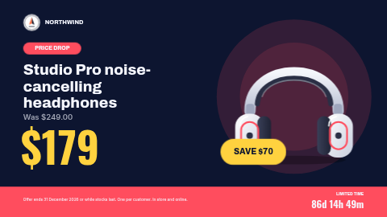

# Price drop promo

A sale screen for a price cut. The product sits on a soft coloured ring with a yellow savings sticker, the headline and the old price sit on the left above a big new price, and a bar along the bottom carries your terms and a live countdown to the end of the offer.

**Kind:** slide (declarative — no code runs). Works on every ScreenTinker player that shows slides.
**Shape:** landscape 16:9 (1920×1080). The same design in portrait is
[`promo-price-drop-portrait`](../promo-price-drop-portrait/). On a zone of another shape the player letterboxes the slide rather than
stretching it, so in a thin strip it shows small and centred: use an info strip or ticker template there.
**Network:** none. **Data source:** none — everything is typed into the settings.

Part of the promo pack: `promo-price-drop`, `promo-bogo`, `promo-new-arrival` and `promo-happy-hour`, each in
landscape and portrait, sharing the same logo and store-name settings so a playlist of them looks like one campaign.

## Settings

| Setting | Type | Default | What it does |
| --- | --- | --- | --- |
| Logo | image | bundled `logo.svg` | Top left. The bundled badge is a placeholder for the fictional "Northwind" stores: replace it with your own (a square-ish PNG or SVG). |
| Show the logo | checkbox | on | Off hides the logo (an empty logo setting with this on shows a faint dashed box). |
| Store name | text (22) | `NORTHWIND` | Shown beside the logo. Leave empty if your logo already includes the name. |
| Badge | text (12) | `PRICE DROP` | The pill above the headline. Leave empty and the pill stays as a plain coloured tab. |
| Product / headline | text (40) | `Studio Pro noise-cancelling headphones` | Room for three lines; 40 characters is the most that always fits. |
| Was-price line | text (28) | `Was $249.00` | Type it as it should read, e.g. "Was $249.00" or "Avant 249,00 €". Leave empty to hide. |
| New price | text (10) | `$179` | The big number, as it should read: $179, 179 €, £1,299.99. |
| Savings sticker | text (10) | `SAVE $70` | On the yellow sticker over the picture. Keep it short: SAVE $70, -30%, HALF PRICE. |
| Product picture | image | bundled `headphones.svg` | A cut-out PNG or SVG with a transparent background looks best; a photo works too. It is fitted inside its box, never cropped. |
| Show the product picture | checkbox | on | Off hides the picture. (An empty picture setting with this on shows a faint dashed box, which is how the slide renderer marks a missing image.) |
| Show the countdown | checkbox | on | Turn off for an offer with no end date: the label and timer both disappear. |
| Label above the countdown | text (20) | `LIMITED TIME` | It stays after the offer ends, so pick words that read well with the end message too. |
| Offer ends at | text (40) | `2026-12-31T23:59:00+00:00` | When the timer reaches zero. **Format below.** |
| Shown when the countdown ends | text (18) | `While stocks last` | Replaces the numbers once the end time has passed. |
| Language | locale | empty | The language of the live countdown, e.g. de or fr-CA. Leave empty for the screen’s language. Your own text is shown exactly as you type it. |
| Small print | text (140) | a sample line | Terms along the bottom bar. A sentence or two. |
| Accent colour | color | `#FF4D5E` | The badge, the bottom bar and the ring behind the picture. |
| Price colour | color | `#FFD23F` | The new price and the savings sticker. |
| Background colour | color | `#0D1530` | Also the text colour on the sticker. |
| Text colour | color | `#F5F7FF` | Headlines and body text. |
| Background photo | image | none | Optional photo behind everything. |
| Darken the photo | number 0–0.9 | `0.6` | A black scrim over the photo so the text stays readable. Ignored without a photo. |

All text is shown exactly as you type it, so prices, currency signs and dates are written the way
your customers read them (`$179`, `179 €`, `£179.99`, `Avant 249,00 €`) — nothing is translated or
reformatted.

### The countdown

**Offer ends at** takes **ISO 8601 with a timezone offset**:

- `2026-11-01T23:59:00+00:00` — one minute to midnight in London (winter), or write `…Z`
- `2026-11-01T23:59:00-05:00` — the same wall-clock time in New York (winter)
- `2026-07-04T18:00:00-04:00` — 6 pm in New York during daylight saving time

Use the offset **in force on that date**. Without an offset the time is read in the ScreenTinker
server's timezone (often UTC). An empty or unreadable value leaves the timer blank and nothing else
changes. The numbers read `12d 7h 50m` while days remain, then `5h 12m 30s`, then `4m 05s`. The
countdown element is handed the **Language** setting, so a server that localises countdowns shows those
units in the screen's language; an older server ignores it and keeps the format above. The timer runs on
each screen's own clock, so keep players on NTP.

When the end time passes, the numbers are replaced by **Shown when the countdown ends**, and the label
above stays. The defaults (`LIMITED TIME` / `While stocks last`) are chosen to read sensibly
both ways. Remember to take the slide out of the playlist (or schedule it) when the offer is over.

## Languages

The settings page is translated into `de`, `es`, `fr`, `hi`, `it`, `ja`, `nl`, `pt`, `zh` (`locales/<lang>.json`; English
in `manifest.json` is the source and the fallback). A server that reads these files shows the setting
names, help and options in the operator's language, and **pre-fills the text settings with translated
sample text** — prices in the local currency and idiomatic short signage lines, each checked against the
setting's maximum length and rendered in German, Japanese and Hindi to make sure it fits. Older servers
ignore the folder and show English; the slide works the same either way.

Every word on the slide is a setting, so the slide shows whatever language you type. The live countdown
is handed **Language** too (see *The countdown*). The bundled slide fonts are Latin-only; Japanese,
Chinese and Hindi text is drawn in the player's system fallback font (for example Noto Sans CJK or Noto
Sans Devanagari), so it renders, in a different typeface. A player with no CJK or Devanagari font at all
shows boxes for those characters. Brand and sample product names (Northwind, Harbour,
Studio Pro) are kept in every language.

## Tips

- Every text setting has a maximum length, and the layout is drawn so that text at that maximum still
  fits without running into the next line (checked with long, wide words in both orientations).
  Slide text boxes do not shrink to fit, so the maximum is the guard: if a word will not fit, shorten it
  rather than looking for a way around it. Short big lines read best from across a room anyway.
- Colours: the defaults are tuned for contrast. If you change the background, check the accent and
  text colours still read from across the room.
- A background photo goes behind the whole slide; raise **Darken the photo** until the
  text is comfortable to read.

## Files

- `locales/` — translations of the settings page (see Languages)
- `template.json` — the slide (`template` = layout, `fields` = the words), with `{{param:…}}` placeholders
- `logo.svg` — placeholder badge, original work, MIT (see `NOTICE`)
- `headphones.svg` — sample product picture, original work, MIT (see `NOTICE`)
- `thumbnail.png` — catalog preview

Licence: MIT (see `LICENSE`).
