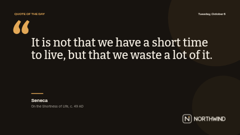

# Quote of the day

A quiet, typography-led quote screen: a large serif quotation under a big accent-coloured quotation mark, the name of who said it and a source line, with today's date in the corner.

Dark espresso background, warm off-white type and an amber accent with two soft discs for depth. Laid out in landscape (16:9). The portrait version is [`quote-of-the-day-portrait`](../quote-of-the-day-portrait/).

**Kind:** slide (declarative, no code runs). Works on every ScreenTinker player that shows slides,
offline, with no internet access.

## Settings

| Setting | Type | Default | What it does |
| --- | --- | --- | --- |
| Small heading | text (40) | `QUOTE OF THE DAY` | A short label above the quote. Capitals read best. |
| Quote | textarea (130) | (sample text) | The quotation, set in Bitter. Leave out the quotation marks: the opening mark is drawn for you. Up to 130 characters. |
| Who said it | text (48) | `Seneca` | The name under the rule, in bold. |
| Source or role | text (80) | `On the Shortness of Life, c. 49 AD` | A book, a role or a year. Leave empty to hide. |
| Show today's date | checkbox | on | A live date drawn by the screen, so it changes at midnight on its own. |
| Date style | select | Weekday, day and month | Weekday + day + month, full date with year, short date, or numbers only. |
| Date timezone | timezone | empty = the screen's clock | Which timezone "today" is in. Leave empty to use the screen's own clock. |
| Language | locale | empty = the screen's language | The language of the date, e.g. en-GB, de-DE or fr-CA. Leave empty for the screen's language. |
| Show the logo | checkbox | on | Off hides the logo and its space stays empty. |
| Logo | image | the bundled `logo.svg` | A PNG or SVG with a transparent background, in a light colour for the default dark background. |
| Accent colour | color | `#E3A857` | The big quotation mark, small heading, rule and decoration. |
| Background colour | color | `#17130F` | Behind everything. |
| Text colour | color | `#F4EEE3` | The quote and the name. |

## Tips

- The quote area is sized for about 130 characters (four lines landscape, seven portrait). A short quote leaves calm space under it, which suits the style.
- Check the wording and attribution of a quote before it goes up: many popular quotes are misattributed.
- To run a different quote each day, make several copies of this widget in a playlist with day-of-week schedules.
- Every element has a fixed place on the slide, so a long text does not push the next block down: it
  runs into it. Stay inside the character limits and preview long text before sending it to screens.
- In a thin strip zone the slide is letterboxed to keep its shape; use a ticker template for strips.

## Languages

The settings page is translated into German, Spanish, French, Hindi, Italian, Japanese, Dutch, Portuguese and Simplified Chinese (`locales/<lang>.json`), and in those languages the
sample texts come translated too, so a new copy starts in the language of the person setting it up.
English in `manifest.json` is the source and the fallback; a server that does not know `locales/`
simply ignores it, and the template works the same.

The date is drawn by the screen in the **Language** setting (empty = the screen's own language),
with that language's month and weekday names. Every other word on screen is one of the settings,
so type it in the language you want.
Japanese, Chinese and Hindi text is drawn with the player's system fonts, because the bundled fonts
cover Latin scripts only. German runs about a third longer than English: preview long text first.

This is one of the **quotes pack**: `quote-of-the-day`, `did-you-know`, `testimonial` and `safety-tip`, each in a landscape and a `-portrait` version with the same settings, so the same message can run on every screen in the building.

## Files

- `template.json`: the slide (`template` = layout, `fields` = the words), with `{{param:…}}` placeholders
- `logo.svg`: placeholder logo for the fictional "Northwind", original work, MIT (see `NOTICE`)
- `locales/*.json`: the settings page in other languages (see Languages)
- `thumbnail.png`: catalog preview

Licence: MIT (see `LICENSE`).
