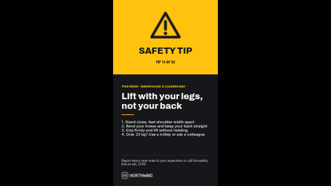

# Safety tip (portrait)

A high-visibility safety tip: a warning icon on a safety-yellow panel with a title and tip number, then the rule in big type, a few how-to steps and a footer saying who to call.

Charcoal page, near-white type and a safety-yellow panel. Laid out in portrait (9:16, for a screen turned on its side). The landscape version is [`safety-tip`](../safety-tip/).

**Kind:** slide (declarative, no code runs). Works on every ScreenTinker player that shows slides,
offline, with no internet access.

## Settings

| Setting | Type | Default | What it does |
| --- | --- | --- | --- |
| Icon | image | the bundled `icon.svg` | On the accent panel. The bundled icon is a dark warning triangle; use your own square PNG or SVG for PPE, fire or first-aid tips. |
| Panel title | text (20) | `SAFETY TIP` | Big words on the accent panel, in the background colour. |
| Tip number | text (24) | `TIP 14 OF 52` | Under the panel title, e.g. "TIP 14 OF 52". Leave empty to hide. |
| Small heading | text (44) | `THIS WEEK · WAREHOUSE & LOADING BAY` | Who or where it is for. |
| Tip | text (48) | `Lift with your legs, not your back` | The rule in a few words. |
| How to | textarea (240) | (sample text) | Up to four short lines; Enter starts a new line. Keep each under about 45 characters. |
| Footer line | text (90) | (sample text) | Who to call or where to report. |
| Show the logo | checkbox | on | Off hides the logo and its space stays empty. |
| Logo | image | the bundled `logo.svg` | A PNG or SVG with a transparent background, in a light colour for the default dark background. |
| Accent colour | color | `#FFC20E` | The panel behind the icon, the small heading and the rule. |
| Background colour | color | `#15171A` | The page. The panel title and tip number are drawn in this colour too. |
| Text colour | color | `#F4F4F1` | The tip, steps and footer. |

## Tips

- A safety tip on a screen supports your training and signage; it does not replace them. Keep wording consistent with your own procedures.
- One rule per screen, four steps at most: people read these while walking past.
- If you change the accent to a dark colour, change the background to a light one too: the panel title is drawn in the background colour.
- Every element has a fixed place on the slide, so a long text does not push the next block down: it
  runs into it. Stay inside the character limits and preview long text before sending it to screens.
- In a thin strip zone the slide is letterboxed to keep its shape; use a ticker template for strips.

## Languages

The settings page is translated into German, Spanish, French, Hindi, Italian, Japanese, Dutch, Portuguese and Simplified Chinese (`locales/<lang>.json`), and in those languages the
sample texts come translated too, so a new copy starts in the language of the person setting it up.
English in `manifest.json` is the source and the fallback; a server that does not know `locales/`
simply ignores it, and the template works the same.

Every word on screen is one of the settings (the slide adds none of its own), so type them in the
language you want.
Japanese, Chinese and Hindi text is drawn with the player's system fonts, because the bundled fonts
cover Latin scripts only. German runs about a third longer than English: preview long text first.

This is one of the **quotes pack**: `quote-of-the-day`, `did-you-know`, `testimonial` and `safety-tip`, each in a landscape and a `-portrait` version with the same settings, so the same message can run on every screen in the building.

## Files

- `template.json`: the slide (`template` = layout, `fields` = the words), with `{{param:…}}` placeholders
- `icon.svg`: warning-triangle icon, original work, MIT
- `logo.svg`: placeholder logo for the fictional "Northwind", original work, MIT (see `NOTICE`)
- `locales/*.json`: the settings page in other languages (see Languages)
- `thumbnail.png`: catalog preview

Licence: MIT (see `LICENSE`).
