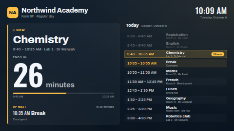

# Schedule board

A now / next board for anything that runs to a timetable: school bells and lessons, gym and studio
classes, factory shifts and breaks, worship and service times. It shows what is on **now** in big
type with a huge **minutes left** countdown and a progress bar, what comes **next**, and today's
timetable beside it with the current block highlighted. Between blocks it counts down to the next
one; outside scheduled hours it says when things start again ("School starts tomorrow at 8:30") and
lists that day instead. When today is short, the rest of the week fills the list.

Type the schedule in (several named schedules, with a setting to pick the active one: a regular day,
exam week, a shutdown rota), or connect a Google Sheet or Manual table so it can be edited from a
phone. Times, weekdays and dates are written in the screen's language (or the one you choose) by the
browser's own `Intl` formatter, in the timezone you choose.

**Kind:** html (code, reviewed). **Network:** none — nothing is fetched; it works fully offline.



## Settings

| Setting | Type | Default | What it does |
| --- | --- | --- | --- |
| Preset | select | School | School bells / timetable, Gym or studio classes, Shifts and breaks, or Worship / service times. Sets the wording (headings, the off-hours message) and the sample schedule shown until you type or connect your own. |
| Schedule | textarea (2000) | empty | One block per line, see *Typing a schedule*. Empty = the preset's sample. |
| Schedule data source | data source | none | Optional. A Google Sheet, CSV, Manual table or REST list, see *Using a Google Sheet*. When it has a Title and a Start (or Time) column it replaces the typed schedule. |
| Active schedule | select 1st–8th | 1st | Which named schedule to show, counted in the order they appear in the text or the sheet. If there are fewer, the first is shown. |
| View | select | Now + today | *Now + today's timetable* (side by side in landscape, stacked in portrait), *Now only* (the biggest countdown), or *Today's timetable only* (with a chip in the header saying what is on and how long is left). |
| Title | text (60) | empty | Empty = the preset's heading ("Bell schedule", "Class timetable", "Shift plan", "Service times"), or the sample's fictional name while the sample is shown. |
| Subtitle | text (80) | empty | One line under the title. The active schedule's name is added after it ("Regular day"). |
| Logo | image | none | Optional, shown beside the title. |
| Show an initials badge when there is no logo | checkbox | on | A rounded square with the title's initials, in the accent colour. |
| Show room and host | checkbox | on | The Room and Host fields, under each title and in the meta line. |
| Warn in the last … minutes | number 0–60 | 2 | The countdown and progress bar turn the warning colour this many minutes before a block ends. 0 = never. |
| Heading: current block / next block / the block after next | text (32) | empty | Empty = the preset's wording (e.g. *Now*, *Up next*, *After that*; *Now on*, *Next class* for the gym preset). |
| Countdown label while a block runs / before a block | text (32) | empty | Empty = *Ends in* / *Starts in*. |
| Message before the first block today | text (80) | empty | Shown big when the day has not started yet. `{time}` is the next start, `{title}` its title. Empty = the preset's, e.g. *School starts at {time}*. |
| Message when the next block is on another day | text (80) | empty | `{day}` is "tomorrow" or a weekday name (in the screen's language), plus `{time}` and `{title}`. Empty = the preset's, e.g. *School starts {day} at {time}*, *Join us {day} at {time}*. |
| Message when nothing is scheduled this week | text (80) | empty | Empty = the preset's, e.g. *No lessons this week*. |
| Heading font | select | Archivo | Archivo (display), Oswald (condensed), Inter (clean) or Bitter (serif). The countdown digits are always Oswald. |
| Accent / Warning / Background / Text colour | colour | `#FFC145` / `#FF6B5B` / `#0D1B2A` / `#F3F6FA` | Accent marks the current block, headings and progress. |
| Time format | select | language default | 24-hour, 12-hour, or hide the clock in the header. |
| Timezone | timezone | empty | The schedule's times are wall-clock times in this timezone. Empty = the screen's own clock. |
| Language | locale | empty | For example `de`, `en-GB`. Empty = the screen's language. The board's own words follow it (see *Languages*); the words you type (titles, headings, your schedule) are shown as typed. |

## Typing a schedule

One block per line, fields separated by `|`:

```
Days | Start-End | Title | Room | Host
Mon-Fri | 08:00-08:50 | Period 1 | Room 12 | Ms Patel
```

- **Days**: `Mon-Fri`, `Tue,Thu`, `Sat-Sun`, `Fri-Mon`, `Weekdays`, `Weekends`, `Daily`, full names
  (`Monday`, `Mondays`), ISO numbers (`1-5`, Monday = 1, Sunday = 7 or 0) or a date (`2026-12-24`).
  Leave the field out entirely (`08:00-08:50 | Period 1`) for every day.
- **Start-End**: `08:00-08:50`, `8:00 am - 8:50 am`, `8.00–8.50`, `22:00 to 06:00`. An end earlier
  than the start runs past midnight (a night shift). Without an end, a block runs until the next one
  starts that day, or for an hour.
- **Title** is required; **Room** and **Host** are optional.
- A line `[Exam week]` (or `# Exam week`, or `== Exam week ==`) starts another named schedule. Pick
  which one is shown with *Active schedule*. Up to 8 schedules, 200 blocks each.

Blocks may overlap; the one that started last is "now" (a break inside a shift). Lines that cannot be
read are skipped. The textarea holds 2000 characters, about 35 lines; use a data source for more.

## Using a Google Sheet

1. Make a sheet with a header row. The column names are matched loosely (case, spaces and punctuation
   don't matter), and these are recognised:

   | Field | Column name (any of) |
   | --- | --- |
   | Days | `Days`, `Day`, `Weekday`, `When`, `Date` |
   | Start | `Start`, `Starts`, `Start time`, `From`, `Begin` |
   | End | `End`, `Ends`, `End time`, `To`, `Until`, `Finish` |
   | Time (instead of Start and End) | `Time`, `Times`, `Hours` holding `08:00-08:50` |
   | Title (required) | `Title`, `Name`, `Event`, `Class`, `Period`, `Session`, `Activity`, `Shift`, `Service`, `Lesson`, `Subject` |
   | Room | `Room`, `Location`, `Where`, `Place`, `Venue`, `Area`, `Studio` |
   | Host | `Host`, `Teacher`, `Instructor`, `Leader`, `Lead`, `Who`, `Presenter`, `Staff`, `Coach`, `Trainer` |
   | Schedule (optional) | `Schedule`, `Timetable`, `Plan`, `Programme` — rows with the same value form one named schedule |

2. In ScreenTinker, *Data sources → New → Google Sheets* and point it at the sheet (or use a
   *Manual table* typed into the dashboard, or a CSV at a URL).
3. Choose that source for *Schedule data source*.

The cells are the same as the typed format: `Mon-Fri` in Days, `08:00` or `8:00 AM` in Start.

**Row limit:** a data source hands an html template at most 300 values today, four of them used for
the table's own information. With the seven columns above that is **about 40 rows** (49 with six
columns, 59 with five); rows beyond that are not seen, and a row cut off part-way is skipped. Every
named schedule in the sheet counts towards it, so for big timetables use one sheet (one data source)
per schedule, or keep only the columns you need. The template never polls: the server re-renders
it whenever the sheet syncs.

## What it shows when

| Situation | Big display | Timetable |
| --- | --- | --- |
| A block is on | *Now*, its title, time · room · host, *Ends in* N minutes, progress | Today, the block highlighted with the minutes left |
| Between two blocks | *Up next*, the next title, *Starts in* N minutes, progress across the gap | Today, the next block marked |
| Before the first block of the day | "School starts at 8:30", *Starts in* 1 hr 20 min | Today |
| After the last block, or on a day off | "School starts Monday at 8:30", *Starts in* 2 days 12 hr | That day (*Tomorrow*, *Monday*) |
| Nothing in the next week | "No lessons this week" | the same message |

In a thin strip zone (wider than about 3:1) it shows one line: the title, what is on now, the
countdown, what is next and the clock.

## Languages

Everything the board writes by itself follows the **Language** setting (empty = the screen's own
language): the presets' headings and messages (*Now*, *Up next*, *Ends in*, *School starts at {time}* …),
the sample schedules (subjects, rooms, shifts, classes, services), and through the browser's `Intl` the
times, weekdays, dates, "today" / "tomorrow" and the units of the countdown ("26 Minuten", "1 Std.
21 Min.", "26 分"). Built in: English, German, Spanish, French, Hindi, Italian, Japanese, Dutch,
Portuguese and Simplified Chinese, picked by the language's first part (`de-CH` uses German); any
other language shows English words with that language's dates and times. A heading or message you
type yourself always wins over the built-in one. Fictional names (Northwind …, people) are not
translated.

The dashboard shows this template's settings in those languages too (`locales/<lang>.json`; older
servers ignore the folder). Day names in a typed schedule are read in English (`Mon-Fri`, `Sat`).
The bundled fonts are Latin only; Japanese, Chinese and Hindi use the player's Noto / system fonts.

## Files

`index.html`, `style.css`, `presets.js` (the four presets' wording and sample schedules), `i18n.js`
(their words in nine more languages), `app.js` —
all inlined by the server at render time. `fonts/` holds the Archivo, Bitter, Inter and Oswald latin
subsets (SIL OFL 1.1, see `NOTICE`). All sample names (Northwind Academy, Northwind Fitness, …) are
fictional.

Licence: MIT (see `LICENSE`); bundled fonts OFL-1.1.
