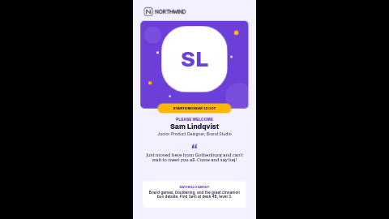

# New starter welcome (portrait)

Welcome someone on their first day: their name and role, a line in their own words, what to say hello about, and a start-date badge. Shows an initials circle until you add a photo.

Laid out in portrait (9:16). The landscape version is [`spotlight-new-starter`](../spotlight-new-starter/), with the same settings.

**Kind:** slide (declarative, no code runs). Works on every ScreenTinker player that shows slides,
offline, with no internet access.

## Settings

| Setting | Type | Default | What it does |
| --- | --- | --- | --- |
| Logo | image | bundled placeholder `logo.svg` | Your logo. Replace the bundled placeholder with an image from your content library. |
| Photo | image | empty | Cropped to a rounded square (`cover`), so the middle of the picture is what shows. A square head-and-shoulders photo is ideal. |
| Show the photo | checkbox | off | Off hides the photo and shows the initials circle underneath it. |
| Initials | text (2) | `SL` | The letters in the initials circle. Type them yourself (a slide cannot work them out from the name). |
| Small heading | text (40) | `PLEASE WELCOME` | The small coloured heading above the name. |
| Name | text (26) | `Sam Lindqvist` | The person, in large type. |
| Role | text (70) | `Junior Product Designer, Brand Studio` | Under the name. |
| Show the quote | checkbox | on | Off hides the quote and the quote mark; the space stays empty. |
| Quote | textarea (150) | sample text | Their own words, without quote marks (the big mark is drawn for you). Enter starts a new line. |
| Quote mark | text (2) | `“` | The large decorative mark by the quote. Change it to suit your language, e.g. « for French. A low mark („) sits on the first line of the quote, so prefer “ or «. |
| Show the fun fact | checkbox | on | Off hides the fun-fact label, text and card. |
| Fun-fact label | text (28) | `SAY HELLO ABOUT` | The small label above the fun fact. |
| Fun fact | textarea (120) | sample text | One or two short sentences. |
| Show the badge | checkbox | on | Off hides the badge and its pill. |
| Badge label | text (22) | `STARTS MONDAY 12 OCT` | The pill near the photo: a month, a start date, a team, years of service. |
| Accent colour | color | `#6D3FD9` | The big card behind the photo, small heading and labels. |
| Highlight colour | color | `#FFB703` | The badge, the short rule and the confetti. |
| Badge text colour | color | `#1C1433` | The words on the badge. |
| Background colour | color | `#F3F0FF` | The slide behind everything. |
| Text colour | color | `#1C1433` | Name, role, quote and fun fact. |
| Card and initials-circle colour | color | `#FFFFFF` | The fun-fact card and the circle behind the initials. |
| Initials colour | color | `#6D3FD9` | The letters in the initials circle. |

## Without a photo

Not everyone wants their face on a screen, and new starters often have no photo yet. Turn off
**Show the photo** and the slide shows a coloured circle with the **Initials** instead; nothing
else moves. With the switch on but no photo chosen, the circle shows ScreenTinker's faint
"missing image" outline over the initials, so turn the switch off rather than leaving the photo empty.

## Tips

- Every element has a fixed place on the slide, and each one has room reserved for its longest
  allowed text: the name is one line of up to 26 characters, the role up to two lines, the quote
  up to four lines and the fun fact up to three. The name is sized for normal mixed case; a
  name typed in ALL CAPS is wider and a very long one can wrap into the role, so preview it first.
  A short role, quote or fun fact leaves the rest of its space empty rather than moving things up.
- The badge holds 22 characters of ordinary capitals. A label made mostly of very wide letters
  (W, M) can wrap out of its pill; shorten it if it does.
- Ask before you put someone's photo, quote or personal fact on a public screen.
- Leaving the small heading, badge, quote or fun fact empty leaves an empty space; use the switches
  to hide the quote, fun fact and badge cleanly.
- On a landscape screen use [`spotlight-new-starter`](../spotlight-new-starter/); this one would be letterboxed.
  In a thin strip zone the slide is letterboxed to keep its shape.
- The logo box is about two and a half times as wide as it is tall. A wide logo fills it; a square one sits
  centred in it.

This is one of the **people spotlight pack**: `spotlight-employee-month`, `spotlight-team-member`,
`spotlight-teacher-volunteer` and `spotlight-new-starter`, each in a landscape and a `-portrait`
version with the same settings, so a template and its partner can share one set of values.

## Languages

The settings panel is translated into German, Spanish, French, Hindi, Italian, Japanese, Dutch, Portuguese (Brazilian) and Simplified Chinese (`locales/<lang>.json`),
and each translation also offers the sample words in that language, with the quote mark that language
uses. English stays in `manifest.json`. The slide has no fixed words of its own: everything on screen is
a setting, so type the words in whatever language the screen should show. Names are never translated.
Japanese, Chinese and Hindi text is drawn with the player's own fonts (the bundled fonts are Latin-only);
it wraps and fits like the English text, and a translated role, quote or fun fact fits the same space.

## Files

- `template.json`: the slide (`template` = layout, `fields` = the words), with `{{param:…}}` placeholders
- `locales/`: translations of the settings panel and the sample words (de, es, fr, hi, it, ja, nl, pt, zh)
- `logo.svg`: placeholder mark for the fictional "Northwind", original work, MIT (see `NOTICE`)
- `thumbnail.png`: catalog preview

Licence: MIT (see `LICENSE`).
