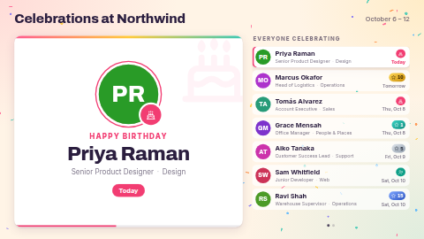

# Team celebrations

Birthdays, work anniversaries and new-starter welcomes for the office, break room or lobby. One
person at a time gets a big card: an initials avatar in a colour worked out from their name, their
name, job title and team, and when it is ("Today", "Tomorrow", "Thu 8 Oct"). Work anniversaries
get a medal with the number of years, coloured for the milestones: **1** (teal), **5** (silver),
**10** (gold), **15** (sapphire) and **20+** (ruby). Beside the card, a list shows everyone
celebrating in the chosen window, with the current person highlighted. The list pages by itself
when there are more people than fit.

When nobody is due, the screen says so in a friendly way and shows who is next (up to a year
ahead), so it never looks broken.

Two themes: **Playful** (light, slowly falling confetti drawn on a canvas) and **Elegant** (dark
navy with gold and a few drifting gold glints). It works in landscape, portrait and as a wide
strip (where it shows just the featured person on one line).

**Kind:** html (code, reviewed). **Network:** none. Nothing is fetched; it works offline.
No photos are used: avatars are initials, so nobody's picture ends up on a lobby screen.

## Settings

| Setting | Type | Default | What it does |
| --- | --- | --- | --- |
| Title | text (60) | `Celebrations at Northwind` | The heading. Empty hides it. |
| Logo | image | none | Optional, shown beside the title. |
| Who to show | select | The next 7 days | *Today only*, *This week* (the calendar week, see below), *The next 7 days*, *This month* (the calendar month) or *The next 30 days*. The dates covered are shown top right. |
| Weeks start on | select | Monday | Monday, Sunday or Saturday. Only used by *This week*. |
| Show birthdays / work anniversaries / new-starter welcomes | checkbox | on | Leave out a kind of celebration. |
| Only milestone anniversaries | checkbox | off | Show anniversaries only at 1, 5, 10, 15, 20, 25 … years. |
| Keep welcoming new starters for (days) | number 0–60 | 14 | A new starter stays on the screen this many days after their first day, whatever the window. 0 = only inside the window. |
| Theme | select | Playful | Playful (light, confetti) or Elegant (dark, gold). |
| Animate the background | checkbox | on | The confetti / glints. Turn off on very slow players; the card rotation keeps working. |
| Seconds per person | number 4–60 | 8 | How long each card stays up. |
| Birthday heading | text | empty | Above the name on a birthday card. Empty: `Happy birthday` in the screen's language. |
| Anniversary heading | text | empty | `{n}` becomes the number of years, e.g. `{n} years with us`. Empty: that line in the screen's language, with the right plural. |
| Anniversary heading for one year | text | empty | Used for a first anniversary, e.g. `1 year with us`. Empty uses the heading above, or the built-in words. |
| New-starter heading | text | empty | Above the name on a welcome card. Empty: `Welcome to the team` in the screen's language. |
| List heading | text | empty | Above the list. Empty: `Everyone celebrating` in the screen's language. A single `-` hides it. |
| Text when nobody is due / Small print | text | empty | The empty screen. Empty: `No celebrations right now` and a friendly line in the screen's language. A single `-` hides the small print. |
| Heading above the next celebration | text | empty | On the empty screen, above the next person within a year. Empty: `Next up` in the screen's language. A single `-` hides it. |
| People data source | data source | none | Optional. A table-shaped source (Google Sheets, CSV, Manual table). When it has the Name column, it replaces the typed people. |
| Name / Type / Birthday / Start date / Job title / Team column | text | `Name`, `Type`, `Date`, `Start date`, `Title`, `Team` | The column headings in your source. Case, spaces and punctuation don't matter (`Start date` matches `start_date`). |
| People | textarea | 14 sample people | One person per line: `Name \| Type \| Date \| Start date \| Title \| Team`. Used when no data source is connected. |
| Timezone | timezone | the screen's clock | Decides when "today" starts and ends. |
| Language | locale | the screen's language | The language of the built-in headings (see *Languages*), "Today"/"Tomorrow", weekdays, months and the date range (`en-GB`, `de-DE`, `fr`, …). |

Dates are worked out on the screen itself, in the chosen timezone, and the list moves on by itself
at midnight. A screen that runs for weeks needs no reload.

## The people table

One row per person (or one row per celebration, if you prefer to use the Type column):

| Name | Type | Date | Start date | Title | Team |
| --- | --- | --- | --- | --- | --- |
| Priya Raman | | 03-14 | 2019-06-03 | Senior Product Designer | Design |
| Marcus Okafor | | | 2016-10-07 | Head of Logistics | Operations |
| Lena Fischer | | 1994-08-21 | 2026-10-05 | Data Engineer | Platform |

- **Name** is the only column that must be there. Rows without a name are skipped.
- **Date** is the birthday: `MM-DD` (`03-14`) or a full `YYYY-MM-DD`. **The year is never shown and
  no age is ever worked out**, so you can leave it out. A 29 February birthday is celebrated on
  28 February in other years.
- **Start date** is the person's first day, `YYYY-MM-DD` (`2019/06/03` works too). It gives a
  **work anniversary** on each later year's date and a **new-starter welcome** from the first day
  until *Keep welcoming new starters for* days after it. A start date in the future, inside the
  window, is welcomed in advance.
- **Type** is optional. Leave it empty and each row gives everything its dates allow (a birthday
  from *Date*, and an anniversary or a welcome from *Start date*). Fill it with `Birthday`,
  `Anniversary` or `New hire` (also `Welcome`, `New starter`, `Joiner`, …) to make the row only that;
  a typed row may then put its one date in either column.
- **Title** and **Team** are shown under the name. Either can be empty.
- Dates may also be written relative to today: `today`, `today+3`, `today-2`, and with a number of
  years: `today+3-5y` (five years ago, three days from now). The sample uses these so the demo is
  always populated; they are handy for testing a sheet, too.

Anything the template cannot read as a date is ignored, never shown as an error on the screen.

### Using a Google Sheet

1. Make a sheet with the header row above (any of the columns except Name may be left out).
2. In ScreenTinker, *Data sources → New → Google Sheets* and point it at the sheet (shared so that
   anyone with the link can view it).
3. Choose that source for *People data source*. If your headings differ, type them into the column
   settings.

If the sheet has synced but has no column matching *Name column*, the screen shows the empty state
with a small line naming the columns it did find, so the mismatch is easy to spot.

### How many people

A data source hands a template **at most 300 values** today. Four of them describe the table, so
with all six columns the screen sees the **first 49 people** of the sheet (with four columns, the
first 74). People further down the sheet are never considered, even when their date is today. Keep
the sheet to your team or site, or sort it by date. A server update that raises this limit is on
its way; the template reads every row it is given, up to 150.

## Languages

The headings the template writes itself (`Happy birthday`, `{n} years with us`, `Welcome to the
team`, `Everyone celebrating`, `Next up`, `Today`, `Tomorrow`, the empty screen and the
missing-column hint) come in English, German, Spanish, French, Hindi, Italian, Japanese, Dutch,
Portuguese and Simplified Chinese, picked by the **Language** setting (empty: the screen's own
language; anything else falls back to English). A heading you type in a setting always wins.
Dates and the years on the medals are formatted by the screen for that language.

The **Type** column understands the words in those languages too (`Geburtstag`, `Jubiläum`,
`Neu im Team`, `誕生日`, `勤続記念`, `新入社員`, `जन्मदिन`, …) as well as English. Column
*headings* are matched as typed in the column settings, so a sheet with German headings needs
those headings typed there.

`locales/` holds dashboard translations of the setting names, help texts, the title and the
sample people (`de`, `es`, `fr`, `hi`, `it`, `ja`, `nl`, `pt`, `zh`). The translated samples are
shorter than the English one (five to eight people), because the catalog keeps every line of a
JSON file under 400 characters. Servers that do not know about `locales/` ignore it; the template
works the same without it.

The bundled fonts cover Latin scripts only. Japanese, Chinese and Hindi text uses the player's own
Noto Sans CJK / Noto Sans Devanagari (or system) fonts. Long German headings shrink to fit their
line.

## Privacy

Only first and last initials, names, titles and teams appear on screen, never a birth year or an
age. If some people prefer not to have their birthday shown, leave their Date empty.

## Files

`index.html` (with the icons and the balloon drawing as inline SVG), `style.css`, `app.js`, all
inlined by the server at render time. `locales/` holds the dashboard translations. `fonts/` holds the Archivo, Bitter and Inter latin subsets
(SIL OFL 1.1, see `NOTICE`).

Licence: MIT (see `LICENSE`); bundled fonts OFL-1.1.
