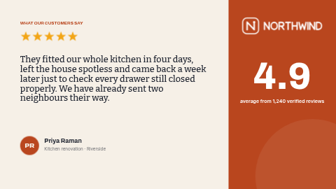

# Customer testimonial

A customer review on screen: a gold star rating, the customer’s words in a warm serif, their name with an initials avatar, and your overall score on a coloured panel.

Cream page, ink-dark type and a burnt-orange accent panel. Laid out in landscape (16:9). The portrait version is [`testimonial-portrait`](../testimonial-portrait/).

**Kind:** slide (declarative, no code runs). Works on every ScreenTinker player that shows slides,
offline, with no internet access.

## Settings

| Setting | Type | Default | What it does |
| --- | --- | --- | --- |
| Small heading | text (40) | `WHAT OUR CUSTOMERS SAY` | A small label above the main text, in the accent colour. Capitals read best. |
| Star rating | select | 5 stars | Gold stars above the quote: 5, 4½, 4 or 3, or hidden. They are drawn in gold whatever the colours below. |
| Testimonial | textarea (220) | (sample text) | The customer’s words, without quotation marks. Up to about 220 characters; shorter reads better. |
| Customer name | text (40) | `Priya Raman` | Only with the customer’s permission. |
| Customer detail | text (60) | `Kitchen renovation · Riverside` | What they bought, where they are from, or "Verified customer". |
| Initials in the avatar | text (3) | `PR` | One to three letters in the round avatar, drawn in the background colour. |
| Show the overall score | checkbox | on | Off hides the big score and its caption. |
| Overall score | text (6) | `4.9` | The big number on the panel. Use your real average and say where it comes from in the caption. |
| Score caption | text (60) | `average from 1,240 verified reviews` | Under the score: say where the number comes from. |
| Show the logo | checkbox | on | Off hides the logo and its space stays empty. |
| Logo | image | the bundled `logo.svg` | A PNG or SVG with a transparent background. The placeholder is white for the coloured panel (landscape) or dark for the page (portrait). |
| Accent colour | color | `#B9461E` | The side panel (landscape) or bottom panel (portrait), the avatar and the small heading. |
| Background colour | color | `#F6F0E7` | The page. The avatar initials are drawn in this colour too. |
| Text colour | color | `#1F2430` | The testimonial and the name. |

## Tips

- Only show a testimonial and a name with the customer’s permission, and keep their words as they wrote them.
- About 120–180 characters reads best across a room; the area takes up to 220.
- The score panel stays when the score is off, so the layout keeps its balance.
- Every element has a fixed place on the slide, so a long text does not push the next block down: it
  runs into it. Stay inside the character limits and preview long text before sending it to screens.
- In a thin strip zone the slide is letterboxed to keep its shape; use a ticker template for strips.

## Languages

The settings page is translated into German, Spanish, French, Hindi, Italian, Japanese, Dutch, Portuguese and Simplified Chinese (`locales/<lang>.json`), and in those languages the
sample texts come translated too, so a new copy starts in the language of the person setting it up.
English in `manifest.json` is the source and the fallback; a server that does not know `locales/`
simply ignores it, and the template works the same.

Every word on screen is one of the settings (the slide adds none of its own), so type them in the
language you want.
Japanese, Chinese and Hindi text is drawn with the player's system fonts, because the bundled fonts
cover Latin scripts only. German runs about a third longer than English: preview long text first.

This is one of the **quotes pack**: `quote-of-the-day`, `did-you-know`, `testimonial` and `safety-tip`, each in a landscape and a `-portrait` version with the same settings, so the same message can run on every screen in the building.

## Files

- `template.json`: the slide (`template` = layout, `fields` = the words), with `{{param:…}}` placeholders
- `stars/*.svg`: the star-rating rows, original work, MIT
- `logo.svg`: placeholder logo for the fictional "Northwind", original work, MIT (see `NOTICE`)
- `locales/*.json`: the settings page in other languages (see Languages)
- `thumbnail.png`: catalog preview

Licence: MIT (see `LICENSE`).
