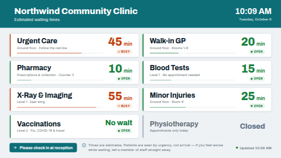

# Wait times board

Estimated waiting times for a clinic, urgent care centre, pharmacy, council office or any service
counter. Each service gets a card with its wait in large numbers, an **Open**, **Busy** or
**Closed** status in clear colours, an optional note (where to go, when it reopens) and a small bar
that compares its wait with the others. A coloured header carries your name, logo and a clock; the
footer carries a check-in reminder, a reassurance notice and the time the figures were last
updated.

Staff keep the numbers current from a phone by editing a Google Sheet or a Manual table, or you can
type the list straight into the settings.

**Kind:** html (code, reviewed). **Network:** none. Nothing is fetched; it works fully offline.



> **Not a live queue caller.** The board shows whatever the data source last synced. A Google
> Sheet or CSV source is re-read on its sync schedule (typically every minute or few), and the
> screen redraws when new values arrive. Use it for estimates that staff update every so often,
> not for "now serving ticket 42".

## Settings

| Setting | Type | Default | What it does |
| --- | --- | --- | --- |
| Title | text (60) | `Northwind Community Clinic` | The big heading in the header band. |
| Subtitle | text (80) | `Estimated waiting times` | One line under the title. Empty hides it. |
| Logo | image | none | Optional, beside the title. A white or transparent logo suits the coloured header. |
| Services | textarea | 8 sample clinic services | One per line: `Service \| Wait \| Status \| Note`. Only the service name is required. Used when no data source is chosen. |
| Wait times data source | data source | none | Optional. A Google Sheet, CSV or Manual table. When chosen it **replaces** the typed services, even before its first sync (the board then shows the "no data" text rather than old figures). A source that is not a table (say, a Weather source picked by mistake) is ignored and your typed services are used, **including the shipped sample figures if you never changed them**. So before putting the board in front of the public, check the source you chose is your table (or clear the Services box). |
| Service / Wait / Status / Note column | text | `Service`, `Wait`, `Status`, `Note` | The column headings in your source. Case, spaces and punctuation don't matter (`Wait (mins)` matches `wait_mins`). If the Service heading matches nothing, the first column is used as the service name. A Wait or Status heading that matches nothing shows dashes and statuses worked out from the wait, so if the board shows dashes, check these names. |
| Notice line | text (200) | an "estimates, seen by urgency" line | Along the bottom. Empty hides it. |
| Check-in note | text (80) | `Please check in at reception` | Highlighted reminder in the footer. Empty hides it. |
| Order | select | As listed | As listed, shortest wait first, or longest wait first. When sorting, closed services go last. |
| Busy from (minutes) | number 1–600 | 40 | A service with an empty status is shown as Busy once its wait reaches this, otherwise Open. |
| Text: open / busy / closed / no wait / updated | text (24; updated 40) | empty | Empty = the built-in words in the screen's language (`Open`, `Busy`, `Closed`, `No wait`, `Updated {time}` in English). A word you type wins. Put `{time}` in the updated text where the time should go (`{time} aktualisiert`); without it the time goes after the text. |
| Text when there is no data | text (80) | empty (= `Waiting times are being updated` in the screen's language) | Shown when the data source has no rows (or has not synced yet), or the list is empty. |
| Show the last-updated time | checkbox | on | The stamp at the bottom right. |
| Remind when figures unchanged for (minutes) | number 0–1440 | 60 | With a data source, the stamp turns amber when **no figure has changed** for this long. This is meant as a reminder to staff to check the sheet is up to date, not a sync alarm: a sync that brings the same figures does not reset it. On a quiet day, raise it; 0 turns it off. |
| Show a wait bar on each service | checkbox | on | A thin bar along each card, its length relative to the longest wait (at least one hour). |
| Theme | select | Light | Light or dark surfaces. |
| Accent colour | colour | `#0E6E78` | The header band and the check-in note. |
| Open / Busy / Closed colour | colour | `#15803D` / `#C2410C` / `#64748B` | The status colours of the cards and pills. |
| Clock | select | Language default | Language default, 24-hour, 12-hour, or hide the clock. Also used for the updated time. |
| Timezone | timezone | screen's clock | For the clock and the updated time. |
| Language | locale | screen's language | The board's own words (see *Languages*), and through the browser's `Intl` the day and month names, the time format and the minute/hour units (`25 min`, `25 Min.`, `1.5 hr`). |
| Seconds per page | number 5–120 | 12 | Only used when there are too many services to fit on one screen at a readable size. |

### Waits

| You type | Shown as |
| --- | --- |
| `25`, `25 min`, `25m` | 25 min |
| `1:30`, `1h 30m`, `90` | 90 min |
| `150` (two hours or more) | 2.5 hr (rounded to the half hour) |
| `15-20` | 15–20 min |
| `0` | the *No wait* text |
| empty | a dash |
| anything else (`Call ahead`) | exactly as typed |

### Status

`Open` (also *available*, *normal*, *quiet*, *short*), `Busy` (also *very busy*, *long*, *delayed*,
*full*) and `Closed` (also *shut*, *paused*, *unavailable*) in any case. A Closed service shows the
closed text in place of a wait, and its card is drawn as an outline. An empty status is worked out
from *Busy from*. Any other word (`Triage only`) is shown as typed, coloured as Open or Busy by its
wait.

### Updated time

With a data source, the stamp is the last time **a figure changed** (`updated` in the source). The
server keeps the old stamp when a sync brings exactly the same data, and the screen is only
re-rendered when something changes, so a perfectly healthy sync of unchanged figures does not move
it. That is intended: the amber reminder (see *Remind when figures unchanged for*) tells staff the
waits have not been touched for a while. With
typed services, it is the time the screen received the values, which is when you last saved them
(or when the screen last restarted). When the time is not today, the date is shown too.

## Using a Google Sheet or Manual table

1. Make a table with a header row: `Service`, `Wait`, `Status`, `Note`, and one row per service.
   ```
   Service          | Wait | Status | Note
   Urgent Care      | 45   | Busy   | Ground floor · Follow the red line
   Pharmacy         | 10   | Open   | Counter 3
   Physiotherapy    |      | Closed | Reopens tomorrow 08:00
   ```
2. In ScreenTinker, *Data sources → New → Google Sheets* (or *Manual table*), point it at the
   table and give it a short sync interval.
3. Choose that source for *Wait times data source*. If your headings differ, type them into the
   column settings.

Rows appear in sheet order (or sorted, see *Order*). **Row limit:** a data source hands a template at
most 300 values today, so with four columns only about the first 70 rows arrive; the board reads at
most 60 services. That is far more than a screen can show: past about 10–16 services the board
pages between screens of cards.

## Layout

The board picks the number of columns and the text size that fill the screen best: two columns of
cards on a landscape screen, one tall column in portrait, and one row of cards beside the title in a
wide strip zone (for example 1920×200), paging when they do not all fit. Long names and notes
shrink a little, then end with an ellipsis.

## Languages

The words the board writes by itself (Open, Busy, Closed, No wait, Updated …, the no-data sentence)
follow the **Language** setting (empty = the screen's own language), as do the times, dates and the
minute/hour units. Built in: English, German, Spanish, French, Hindi, Italian, Japanese, Dutch,
Portuguese and Simplified Chinese, picked by the language's first part (`fr-CA` uses French); other
languages show English words with their own dates and times. Statuses typed in a sheet are
recognised in all of these languages (`Offen`, `Fermé`, `混雑`, `बंद` …) as well as in English.

The dashboard shows the settings in those languages too, with the title, notice, check-in note and
sample services already translated (`locales/<lang>.json`; older servers ignore the folder). The
translated column names (`Wartezeit`, `Attente` …) fall back to the English headings, so a sheet set
up with `Service`, `Wait`, `Status`, `Note` keeps working. A sheet heading in Japanese, Chinese or
Hindi script is read as `col1`, `col2` …, so either use Latin headings or type `col2` as the column
name. The bundled fonts are Latin only; Japanese, Chinese and Hindi use the player's Noto / system
fonts.

## Files

`index.html`, `style.css`, `app.js` — all inlined by the server at render time. `fonts/` holds the
Archivo and Inter latin subsets (SIL OFL 1.1, see `NOTICE`). The icons are inline SVG drawn for this
template.

Licence: MIT (see `LICENSE`); bundled fonts OFL-1.1.
