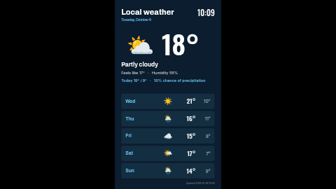

# Weather forecast (portrait)

Current conditions and a five-day forecast, laid out for a screen turned on its side (9:16): the
location, date and a live clock at the top, a big icon and temperature with today's details below,
and the next five days as a list of rows. The numbers come from one of your own **Weather data
sources**: your server fetches the weather (Open-Meteo by default, no key needed) and the template
only arranges it.

The landscape version is [`weather-forecast`](../weather-forecast/). Both have exactly the same
settings.

**Kind:** slide (declarative, no code runs). Works on every ScreenTinker player that shows slides.

## Before you use it

Create a data source of type **Weather** (Data Sources → New → Weather) with your location, units
and language. Then pick it in this template's **Weather data source** setting. Units (°C/°F) and
day names follow the data source's settings. Until a source is chosen and has synced, the slide
shows the raw `{{ds:…}}` references, which is why the setting is required.

## Settings

| Setting | Type | Default | What it does |
| --- | --- | --- | --- |
| Weather data source | data source (required) | none | Where the numbers come from. |
| Location name | text (60) | `Local weather` | The heading, top left. Up to about 15 characters stay on one line beside the clock. |
| Temperature suffix | text (4) | `°` | Shown after every temperature: `°` on its own, or `°C` / `°F` to match the data source. |
| Feels-like / Humidity / Today / Precipitation / Updated label | text (24 / 24 / 16 / 32 / 24) | `Feels like` / `Humidity` / `Today` / `Chance of precipitation` / `Updated` | The words in front of the values; change them to match the screen's language. |
| Accent colour | colour | `#6CC4F0` | Date, today's line, day names, rule and the row tint. |
| Background colour | colour | `#0B1D2E` | The page. |
| Text colour | colour | `#FFFFFF` | Everything else. |
| Clock timezone | timezone | empty = the screen's clock | Which timezone the clock and date show. |
| Language | locale | empty = the screen's language | The date is formatted by the screen in this language (`en-GB`, `de-DE` …). |
| Clock format | 24-hour / 12-hour | 24-hour | |

## How it reads the data

Every value is a `{{ds:<source>.<key>}}` reference, built from the chosen source as
`{{ds:{{param:weather}}.temperature}}`. It uses `icon`, `temperature`, `condition`,
`apparent_temperature`, `humidity`, `day0_high/low/precip_prob` (today) and `day1…day5`
`_name/_icon/_high/_low`, plus `updated`. The icons are the data source's emoji, drawn by the
player's own emoji font. The server re-renders the slide whenever the data source syncs.

## Languages

The dashboard shows this template's name, description and every setting's label and help in English, German,
Spanish, French, Hindi, Italian, Japanese, Dutch, Portuguese and Chinese (`locales/<lang>.json`; a
server without translation support simply shows English). The words on the slide that are not weather data —
"Feels like", "Humidity", "Today", "Chance of precipitation" and "Updated" — are settings, and
start out in the dashboard's language (for example `Gefühlt`, `Luftfeuchte`, `Heute`,
`Niederschlagsrisiko`, `Aktualisiert` in German). The date follows the **Language** setting (empty =
the screen's language). The forecast day names come from the data source's own language setting; the
condition text ("Partly cloudy") is produced by the server's Weather data source and is currently
English only. The slide renderer's bundled fonts cover Latin; Japanese, Chinese and Hindi fall back to the screen's own
fonts (Noto on ScreenTinker players).

## Tips

- A very long condition ("Thunderstorm with slight hail") can wrap to a second line and touch the
  "Feels like" line beneath it; the built-in source's condition names are short enough.
- On a landscape screen or a strip zone the slide is letterboxed to keep its shape. Use
  `weather-forecast` for landscape screens.

Licence: MIT (see `LICENSE`).
